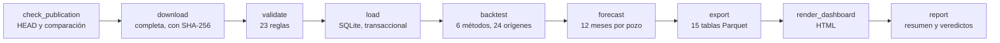
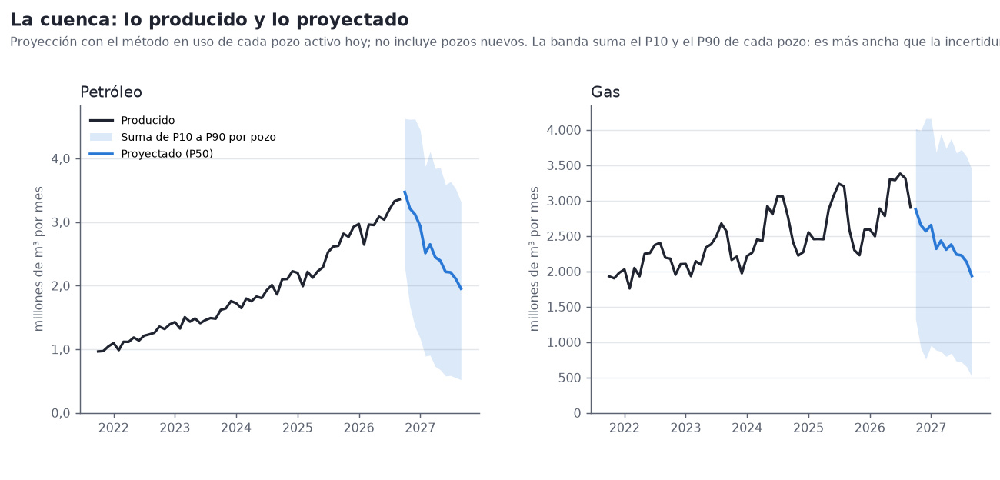

# Producción de petróleo y gas, pozo por pozo

| | |
| --- | --- |
| **Propuesta de valor** | Una proyección a 12 meses de la producción de cada pozo no convencional de la cuenca Neuquina, con bandas P10-P90 y el error medido de cada método frente a repetir el último mes |
| **Stack tecnológico** | Python 3.11, pandas, NumPy, SciPy, scikit-learn, SQLite y SQL, Parquet (PyArrow), Matplotlib, pytest, Apache Airflow sobre Docker Compose, y el diseño de un tablero de Power BI en HTML |
| **Técnicas** | Curvas de declinación de Arps, gradient boosting con pérdida cuantílica, líneas base ingenuas, validación walk-forward, bandas P10/P50/P90, ablación |
| **Para auditar** | [Ficha del modelo](docs/model-card.md) · [Evaluación independiente](docs/evaluation.md) · [Última corrida: validación](reports/validation/latest.md) · [Última corrida: resultados](reports/backtest_summary.md) |

Este README sigue la estructura común de los proyectos de datos del portafolio, descrita en `ESTRUCTURA-PROYECTOS.md` en la raíz del portafolio.

## 1. Resumen ejecutivo

### 1.1 Problema de negocio y solución

Un flujo automático que toma la publicación mensual de la Secretaría de Energía, la valida, proyecta la producción de cada pozo no convencional de la cuenca Neuquina con curvas de declinación de Arps y con machine learning, y mide con qué error lo hace cada método frente a repetir el último mes.

**El problema.**

La Secretaría de Energía publica cada mes la producción de cada pozo. El dato es abierto (CC BY 4.0), pero llega crudo: solo para los pozos no convencionales es un CSV de 149 MB con 431.322 filas y 40 columnas, con huecos, meses sin movimiento (el 20,3 % de las filas no tiene petróleo ni gas), valores negativos y republicaciones de meses anteriores.

Quienes lo necesitan son los equipos de planificación de una operadora (presupuestos, compromisos de entrega, capacidad de instalaciones), las empresas de servicios que anticipan actividad y los organismos públicos que proyectan regalías. Hoy cada mes alguien descarga el archivo, lo filtra a mano y rehace las proyecciones en planillas, con criterios que cambian según quién las arma. Y casi nunca se mide cuánto se equivocaron: sin esa medición no se sabe si una curva de declinación es mejor que repetir el último mes.

**La solución.**

Un flujo que, sin intervención, verifica cada día si hay una publicación nueva, la descarga completa y la valida con 23 reglas; si la acepta, la carga en una base SQL, ajusta una curva de Arps a cada pozo, la compara con un modelo de machine learning y con dos líneas base ingenuas mediante una validación mes a mes (walk-forward) con bandas P10, P50 y P90, y deja las tablas listas para un tablero de Power BI en modelo estrella junto con el diseño del tablero en HTML. Si la publicación está dañada, la rechaza y deja todo lo anterior intacto.

El resultado central no es una curva sino una medición: para cada método, horizonte y fluido, cuánto error tiene y en cuántos pozos le gana a repetir el último mes, con criterios de aceptación fijados antes de mirar los datos.

**Para qué sirve.**

- **Planificación de una operadora:** una proyección a 12 meses por pozo, con banda, para presupuestos y compromisos de entrega, y una medición honesta de cuánto confiar en ella: a 12 meses el error total ronda el 42 % con machine learning y el 53 % con curvas de Arps.
- **Elegir el método:** el proyecto no asume que una curva de declinación sea mejor que repetir el último mes: lo mide. Hoy, a 1 mes conviene repetir el último mes; desde 6 meses, la curva; y en todos los horizontes el machine learning rinde más.
- **Empresas de servicios y organismos públicos:** comparar yacimientos y operadoras con el mismo criterio y proyectar actividad y regalías.
- **Una publicación nueva sin trabajo manual:** el flujo la detecta, la valida y rehace todo; si el archivo cambió de forma o se dañó, lo rechaza sin tocar lo anterior.
- **Para un tablero:** las tablas en estrella y el diseño en HTML dicen cómo armar las cinco páginas en Power BI Desktop.

Lo que no sirve: certificar reservas, proyectar precios o agua, ni anticipar una fractura nueva o un cierre que todavía no ocurrió. Y la proyección de la cuenca suma pozos que hoy están activos, sin pozos nuevos.

### 1.2 Criterios de éxito e impacto

Los criterios de aceptación se fijaron antes de correr nada: la curva de Arps debía superar a repetir el último mes en al menos el 60 % de los pozos a 12 meses, y las bandas P10-P90 debían cubrir entre el 70 % y el 90 % de los valores reales. **Los dos se cumplen**: a 12 meses la curva supera a repetir el último mes en el 61,88 % de los pozos de petróleo y el 64,09 % de los de gas, y las bandas cubren entre 0,77 y 0,81 de los valores reales (objetivo 0,80). Cada criterio contra su resultado, en [5.1](#51-evaluación-frente-a-criterios-de-éxito).

## 2. Datasets y preparación

### 2.1 Fuentes, alcance y granularidad

| | |
| --- | --- |
| Fuente | Secretaría de Energía de la Nación, «Producción de petróleo y gas por pozo (Capítulo IV)», archivo de pozos no convencionales |
| Publicación usada | 2026-10-22, 148.923.474 bytes, 431.322 filas, 40 columnas, UTF-8 con BOM |
| Subconjunto | cuenca Neuquina, no convencional, toda la historia: 413.865 filas, 4.937 pozos, 52 operadoras, 139 yacimientos, de 2006-01 a 2026-09 |
| Unidades | petróleo y agua en m³, gas en miles de m³, por mes |
| Calidad | 20,3 % de las filas sin petróleo ni gas; 2 gases negativos; 70 filas con más días de extracción que días del mes; 176 pozos con profundidad inválida |
| Aparte | el archivo preliminar de fractura (solo en la ablación, que mostró que no mejora el modelo; decisión D38) |

La unidad de análisis es una serie: un pozo y un fluido, con su tasa mensual por día calendario (volumen dividido por los días del mes). Un mes sin fila es un dato faltante; un mes con volumen cero es un cero real (`docs/model-card.md`).

Cada columna con su unidad está en [docs/data-dictionary.md](docs/data-dictionary.md).

La atribución y la licencia están al final, en [Fuente y licencia](#fuente-y-licencia).

### 2.2 Saneamiento y reglas de calidad

El archivo pasa por 23 reglas de validación antes de cargarse: 10 bloqueantes (V01 a V10), 10 de advertencia (V11 a V20) y 3 informativas. Si una bloqueante falla, la publicación se rechaza y todo lo anterior queda intacto. Las de advertencia corrigen a nulo (volúmenes negativos, días efectivos mayores que los días del mes, profundidad fuera de rango) o conservan el dato y lo marcan (días en cero con producción). Cada regla con su recuento real, en [reports/validation/latest.md](reports/validation/latest.md).

Lo que se midió sobre la publicación real: 20,3 % de las filas sin petróleo ni gas, 2 gases negativos, 70 filas con más días de extracción que días del mes y 176 pozos con profundidad inválida (fila «Calidad» de 2.1). Qué hacer ante cada rechazo, en [docs/runbook.md](docs/runbook.md).

## 3. Arquitectura y metodología

Nueve tareas que corren siempre en este orden, las mismas desde la línea de comandos (`python -m oilgas run`) y desde el DAG de Apache Airflow (`oilgas_monthly_production`, una vez por día): detectan la publicación, la descargan y la validan, la cargan en SQL, miden seis métodos con un backtest, proyectan 12 meses por pozo y exportan las tablas y el diseño del tablero.

### 3.1 Fuente e ingesta

La primera tarea (`check_publication`) compara la publicación con la última conocida mediante un `HEAD` y corta el flujo si no cambió; la segunda (`download`) descarga el archivo completo y calcula su SHA-256.

Sobre la integridad de la descarga, tal cual es: la fuente solo ofrece HTTP, sin TLS. El SHA-256 del archivo se **calcula y se guarda** en el manifiesto y en la corrida, pero **no se verifica** contra un valor de confianza (la fuente no publica ninguno); sirve para identificar el archivo y detectar que cambió entre corridas, no para probar que nadie lo alteró en el camino. Lo que sí se comprueba es que el tamaño recibido sea el anunciado por `HEAD`, y después las 23 reglas de validación.

### 3.2 Orquestación y transformación



La primera tarea corta el flujo si la publicación no cambió; la tercera lo corta, sin tocar nada, si el archivo no cumple el contrato.

El DAG de Airflow se probó en Docker en modo rápido: `pytest -m docker` (tests/e2e/test_airflow_docker.py) construyó la imagen de `airflow/`, levantó la base y el servicio de inicialización del compose y corrió `airflow dags test oilgas_monthly_production` sobre una publicación sintética. Terminó con éxito en 57 segundos, con las tablas y el diseño HTML escritos (Docker Desktop 28.5.1, Airflow 3.4.0, el 9 de noviembre de 2026). Antes se había verificado de forma estática, con pruebas sobre el código del DAG y con `docker compose config`, porque Docker Desktop estaba apagado. Con esa prueba quedó probado el criterio AC19.

### 3.3 Almacenamiento y modelado de datos

- **Almacén transaccional:** la tarea `load` carga la publicación aceptada en SQLite, con archivos SQL, en una sola transacción (decisión D04, `docs/decisions.md`).
- **Tablas para Power BI:** 15 archivos Parquet (8 dimensiones y 7 hechos) en `outputs/powerbi/`, con relaciones uno a varios y filtro en un solo sentido, claves únicas e integridad referencial verificadas.

### 3.4 Experimentación y Machine Learning

Los criterios de aceptación se fijaron antes de correr nada y no se movieron después de ver los resultados (`[criteria]` de `config/pipeline.toml`); los hiperparámetros son fijos, sin búsqueda, para que ningún método se optimice contra el resultado; las semillas están fijadas (42), las versiones de las dependencias están fijadas con `==` en `requirements.txt` y el backtest da el mismo resultado con 1 y con 2 procesos (prueba AC22). Cada decisión de diseño está en [docs/decisions.md](docs/decisions.md) con su contexto, sus opciones, su motivo y lo que afecta. Ecuaciones, límites y advertencias, en [docs/model-card.md](docs/model-card.md).

#### 3.4.1 Ingeniería de características y línea base (baseline)

- **Dos líneas base:** repetir el último mes y el promedio de los últimos tres.

El machine learning recibe solo datos hasta el mes de origen: las tasas más recientes, medias y tendencias, el pico y la distancia a él, los meses en cero, la relación gas-petróleo, el mes calendario del mes objetivo y atributos del pozo (profundidad, formación, tipo, extracción y operadora). La lista completa está en la ficha del modelo, sección «Métodos».

#### 3.4.2 Decisiones de modelado y ablación (ADR)

| Decisión | Elegido | Por qué | Descartado |
| --- | --- | --- | --- |
| Enfoque (D01) | Curvas de Arps y machine learning, comparados entre sí y con líneas base ingenuas, sobre el mismo conjunto de evaluación | Responde cuándo una curva suma algo a un método más simple y obliga a medir las dos cosas contra una línea base | Solo curvas de Arps (no dice si superan a repetir el último mes); solo machine learning (no se explica pozo por pozo) |
| Curvas de Arps (D06) | Tres variantes fijas: exponencial y dos hiperbólicas modificadas (b hasta 2 como caso base, b hasta 1 como sensibilidad), con declinación terminal del 10 % anual | Elegir la variante por pozo con el error de prueba es una fuga; fijar la base de antemano hace justa la comparación | Elegir la variante pozo por pozo según el error de prueba |
| Machine learning (D08) | `HistGradientBoostingRegressor` con pérdida cuantílica, un modelo por fluido, horizonte y cuantil, con hiperparámetros fijos | Da los tres cuantiles sin otro método y acepta categorías y nulos | LightGBM (suma una librería), bosque aleatorio, red recurrente (desproporcionada para unas 6.000 series mensuales) y regresión cuantílica lineal |
| Método en uso (D11) | Por fluido y segmento, el de menor pinball escalada promedio en los horizontes 1, 3, 6 y 12; en un empate, el más simple | Elegir por los datos y con una regla escrita antes es honesto; la pinball mide a la vez el P50 y las bandas | Usar siempre Arps o siempre el machine learning |
| Datos de fractura (D15, D38) | Fuera del modelo base; su aporte se midió en una ablación | El archivo es preliminar y el 41 % de sus longitudes de rama figuran como 0 | Sumarlo al modelo base. La ablación mostró que no mejora ninguna de las 16 celdas |

#### 3.4.3 Protocolo de validación (backtesting / cross-validation)

- **Validación walk-forward:** 36 orígenes mensuales (12 de calentamiento y 24 de evaluación) y horizontes de 1, 3, 6 y 12 meses, con el mismo conjunto de pares para todos los métodos y sin fuga de información, comprobada con pruebas.
- **Bandas:** de los errores ya realizados antes de cada origen para los métodos puntuales; de la regresión cuantílica para el machine learning.

Las métricas son el WAPE (el error relativo del total; el MAPE no sirve con meses en cero), MAE, RMSE, sesgo, la cobertura de la banda P10-P90 y la pérdida pinball escalada.

### 3.5 Consumo y gobernanza

- **Reportes automáticos:** los genera el propio flujo en `reports/` (ver 4.1); `python -m oilgas docs-sync` copia el bloque de resultados en este README y llena las tablas generadas de `docs/`.
- **Ficha del modelo:** [docs/model-card.md](docs/model-card.md), con los métodos, la validación, todas las celdas de resultados y los límites.
- **Documentación del proyecto:**

| Documento | Qué contiene |
| --- | --- |
| [docs/research.md](docs/research.md) | La investigación del dataset y del stack |
| [docs/requirements.md](docs/requirements.md) | Requerimientos, datos medidos y criterios de aceptación |
| [docs/plan.md](docs/plan.md) | Arquitectura, módulos y unidades de trabajo |
| [docs/decisions.md](docs/decisions.md) | Registro de decisiones (D01-D44), con motivo y lo que afecta cada una |
| [docs/data-dictionary.md](docs/data-dictionary.md) | Diccionario de datos con unidades |
| [docs/model-card.md](docs/model-card.md) | Ficha del modelo: métodos, validación, resultados y límites |
| [docs/runbook.md](docs/runbook.md) | Qué hacer ante una publicación atrasada, un cambio de forma, una descarga fallida y más |
| [docs/paso-a-paso.md](docs/paso-a-paso.md) | Cómo se construyó, unidad por unidad |
| [docs/review-advisories.md](docs/review-advisories.md) | Las advertencias de las revisiones nativas, en su texto original |

## 4. Producto final

### 4.1 Entregables operativos

- **Diseño del tablero:** [dashboard/powerbi-design.html](dashboard/powerbi-design.html), un solo archivo autocontenido con los pasos para armarlo en Power BI Desktop, el diagrama del modelo, las 25 relaciones, las consultas de Power Query, las medidas DAX y cinco páginas con vistas previas dibujadas con los números reales. Armar el `.pbix` requiere la interfaz gráfica de Power BI Desktop y no está hecho: el HTML es el diseño de cómo se haría.
- **Reportes:** `reports/backtest_summary.json` y `.md` (los resultados de arriba) y `reports/validation/latest.md` (la última validación).
- **Orquestación:** CLI y DAG de Airflow sobre Docker Compose.

La orquestación se probó de punta a punta en modo rápido sobre datos sintéticos (3.2); la corrida real completa se hizo con la línea de comandos, en Windows.

### 4.2 Lectura de resultados actuales

Corrida real del 2026-11-09 sobre la publicación del 2026-10-22 (se repitió el mismo día con el código corregido tras la evaluación independiente, con resultados idénticos): 4.937 pozos, 24 orígenes de evaluación (2024-09 a 2026-08), cuatro horizontes (1, 3, 6 y 12 meses) y 2.879.616 pronósticos evaluados. El bloque completo de resultados está en [Resultados completos de la corrida](#resultados-completos-de-la-corrida); la validación de esa publicación, en [reports/validation/latest.md](reports/validation/latest.md).




## 5. Conclusión

### 5.1 Evaluación frente a criterios de éxito

| Criterio fijado de antemano | Resultado |
| --- | --- |
| La curva de Arps supera a repetir el último mes en al menos el 60 % de los pozos a 12 meses | Cumple: 61,88 % en petróleo y 64,09 % en gas |
| Las bandas P10-P90 cubren entre el 70 % y el 90 % de los valores reales | Cumple: entre 0,77 y 0,81 (objetivo 0,80) |

El bloque que copia `reports/backtest_summary.md`, con todas las cifras y las tablas de WAPE por método y horizonte, está en [Resultados completos de la corrida](#resultados-completos-de-la-corrida); dice también lo que no favorece.

**Cómo leerlo.**

- A 12 meses la curva de Arps le gana a repetir el último mes en el 62 % de los pozos de petróleo y el 64 % de los de gas, y baja el error total (WAPE) de 72 % a 53 %. El margen sobre el umbral es chico en petróleo: 1,9 puntos.
- A 1 mes **no supera** a repetir el último mes (WAPE 31,6 % contra 23,1 % en petróleo; le gana en el 20 % de los pozos), y a 3 meses la ventaja es mínima. La curva empieza a pagar desde los 6 meses.
- El machine learning es el mejor método en todas las celdas (WAPE a 12 meses: 42 % en petróleo y 47 % en gas) y por eso es el método en uso por defecto. Le gana a repetir el último mes en el 72 % y el 74 % de los pozos a 12 meses. Aporta más en los pozos jóvenes, donde la curva de Arps no puede ajustarse.
- Las bandas P10-P90 cubren entre 0,77 y 0,81 de los valores reales (objetivo 0,80). Las del machine learning quedan algo por debajo del objetivo, dentro de «calibrado».
- Los datos de fractura (preliminares) **no mejoran** el machine learning: en una ablación sobre los mismos 506.386 pares no mejoran ninguna de las 16 celdas (cambio medio de la pinball escalada: +0,7 %), con una regla de decisión que, según el registro, se escribió antes de correrla (decisión D38; en Git se confirmó junto con sus resultados, así que la anterioridad no se puede comprobar desde el historial). Quedan fuera del modelo base.
- Una evaluación independiente recalculó las cifras principales de la primera corrida y coincidieron con las publicadas ([docs/evaluation.md](docs/evaluation.md)). Encontró tres bloqueantes (una fuga de información en el backtest, una opción que se ignoraba en silencio y un modo rápido que escribía sobre las salidas versionadas) y varias advertencias; se corrigieron con la prueba primero, un segundo evaluador volvió a correr las sondas de los tres bloqueantes (fallaban antes de las correcciones y pasan ahora) y se repitió la corrida completa: no cambió ninguna cifra de este bloque.
- Lo que sigue pendiente de verificar: la estabilidad en otras ventanas de tiempo. El DAG de Airflow ya se probó en Docker, en modo rápido (ver 3.2). Todas las celdas, método por método, están en la [ficha del modelo](docs/model-card.md).


### 5.2 Limitaciones metodológicas

- **Lo que no se probó:** la corrida diaria programada de Airflow sobre la publicación real (la corrida completa se probó con la CLI, en Windows) y el `.pbix`, que no se armó: el diseño en HTML dice cómo hacerlo.
- **Datos ya revisados:** el backtest usa la publicación de hoy, con las correcciones que la Secretaría hizo después, no las versiones que existían en cada mes; los errores reales en producción pueden ser algo mayores.
- **Una sola ventana:** los 24 orígenes cubren 2024-09 a 2026-08 y no se midió la estabilidad del resultado con otras ventanas. Los horizontes intermedios del pronóstico (2, 4, 5 y 7 a 11 meses) no se validaron uno por uno.
- **Cierres, intervenciones y series jóvenes:** una fractura nueva, un cierre largo o un cambio de operadora rompen la hipótesis de una declinación continua; con menos de 6 puntos desde el pico no hay curva de Arps.
- **Bandas de la cuenca:** la suma de las bandas por pozo no es la banda del total, y la proyección de la cuenca suma pozos que hoy están activos, sin pozos nuevos.
- **Integridad de la descarga:** el SHA-256 se guarda pero no se verifica contra un valor de confianza (ver 3.1).

La lista completa está en la ficha del modelo, sección «Limitaciones».

### 5.3 Trabajo futuro

Lo que la documentación deja pendiente (`docs/evaluation.md`, «Lo que queda», y la ficha del modelo): armar el `.pbix` a partir del diseño en HTML, medir el pico de memoria de la corrida completa, acercar la suite de pruebas rápida a los 180 segundos pedidos (hoy ronda los 185) y repetir el backtest con otras ventanas de tiempo.

## Resultados completos de la corrida

El bloque siguiente se copia de `reports/backtest_summary.md`, que genera el propio flujo.

<!-- results:start -->
### Curva de Arps frente a repetir el último mes

**Petróleo.** Cumple el criterio fijado de antemano.
- A 12 meses, la curva de Arps supera a repetir el último mes en el 61,88 % de los pozos (umbral: 60 %).
- A 6 meses, el WAPE de la curva de Arps (44,92 %) es menor que el de repetir el último mes (53,04 %).
- A 12 meses, el WAPE de la curva de Arps (52,55 %) es menor que el de repetir el último mes (71,77 %).

**Gas.** Cumple el criterio fijado de antemano.
- A 12 meses, la curva de Arps supera a repetir el último mes en el 64,09 % de los pozos (umbral: 60 %).
- A 6 meses, el WAPE de la curva de Arps (43,73 %) es menor que el de repetir el último mes (54,42 %).
- A 12 meses, el WAPE de la curva de Arps (53,37 %) es menor que el de repetir el último mes (72,6 %).

### Cobertura de las bandas P10-P90

Objetivo 0,80: calibrado entre 0,75 y 0,85, aceptable entre 0,70 y 0,90, descalibrado fuera de ese rango.

- A 1 mes, la cobertura P10-P90 de la curva de Arps en petróleo es 0,81 (objetivo 0,80): calibrado.
- A 1 mes, la cobertura P10-P90 del modelo de machine learning en petróleo es 0,79 (objetivo 0,80): calibrado.
- A 3 meses, la cobertura P10-P90 de la curva de Arps en petróleo es 0,81 (objetivo 0,80): calibrado.
- A 3 meses, la cobertura P10-P90 del modelo de machine learning en petróleo es 0,78 (objetivo 0,80): calibrado.
- A 6 meses, la cobertura P10-P90 de la curva de Arps en petróleo es 0,81 (objetivo 0,80): calibrado.
- A 6 meses, la cobertura P10-P90 del modelo de machine learning en petróleo es 0,78 (objetivo 0,80): calibrado.
- A 12 meses, la cobertura P10-P90 de la curva de Arps en petróleo es 0,80 (objetivo 0,80): calibrado.
- A 12 meses, la cobertura P10-P90 del modelo de machine learning en petróleo es 0,78 (objetivo 0,80): calibrado.
- A 1 mes, la cobertura P10-P90 de la curva de Arps en gas es 0,80 (objetivo 0,80): calibrado.
- A 1 mes, la cobertura P10-P90 del modelo de machine learning en gas es 0,78 (objetivo 0,80): calibrado.
- A 3 meses, la cobertura P10-P90 de la curva de Arps en gas es 0,80 (objetivo 0,80): calibrado.
- A 3 meses, la cobertura P10-P90 del modelo de machine learning en gas es 0,78 (objetivo 0,80): calibrado.
- A 6 meses, la cobertura P10-P90 de la curva de Arps en gas es 0,80 (objetivo 0,80): calibrado.
- A 6 meses, la cobertura P10-P90 del modelo de machine learning en gas es 0,79 (objetivo 0,80): calibrado.
- A 12 meses, la cobertura P10-P90 de la curva de Arps en gas es 0,79 (objetivo 0,80): calibrado.
- A 12 meses, la cobertura P10-P90 del modelo de machine learning en gas es 0,77 (objetivo 0,80): calibrado.

### Aporte del machine learning

- A 1 mes, en petróleo (series elegibles), el modelo de machine learning supera a la curva de Arps (pinball escalada 0,23 frente a 0,36).
- A 3 meses, en petróleo (series elegibles), el modelo de machine learning supera a la curva de Arps (pinball escalada 0,33 frente a 0,45).
- A 6 meses, en petróleo (series elegibles), el modelo de machine learning supera a la curva de Arps (pinball escalada 0,37 frente a 0,52).
- A 12 meses, en petróleo (series elegibles), el modelo de machine learning supera a la curva de Arps (pinball escalada 0,42 frente a 0,61).
- A 1 mes, en petróleo (series jóvenes), el modelo de machine learning supera al promedio de los últimos 3 meses (pinball escalada 0,21 frente a 0,62).
- A 3 meses, en petróleo (series jóvenes), el modelo de machine learning supera al promedio de los últimos 3 meses (pinball escalada 0,33 frente a 0,90).
- A 6 meses, en petróleo (series jóvenes), el modelo de machine learning supera al promedio de los últimos 3 meses (pinball escalada 0,41 frente a 1,00).
- A 12 meses, en petróleo (series jóvenes), el modelo de machine learning supera al promedio de los últimos 3 meses (pinball escalada 0,46 frente a 1,09).
- A 1 mes, en gas (series elegibles), el modelo de machine learning supera a la curva de Arps (pinball escalada 0,27 frente a 0,39).
- A 3 meses, en gas (series elegibles), el modelo de machine learning supera a la curva de Arps (pinball escalada 0,35 frente a 0,46).
- A 6 meses, en gas (series elegibles), el modelo de machine learning supera a la curva de Arps (pinball escalada 0,38 frente a 0,52).
- A 12 meses, en gas (series elegibles), el modelo de machine learning supera a la curva de Arps (pinball escalada 0,45 frente a 0,64).
- A 1 mes, en gas (series jóvenes), el modelo de machine learning supera al promedio de los últimos 3 meses (pinball escalada 0,24 frente a 0,64).
- A 3 meses, en gas (series jóvenes), el modelo de machine learning supera al promedio de los últimos 3 meses (pinball escalada 0,38 frente a 0,92).
- A 6 meses, en gas (series jóvenes), el modelo de machine learning supera al promedio de los últimos 3 meses (pinball escalada 0,42 frente a 0,95).
- A 12 meses, en gas (series jóvenes), el modelo de machine learning supera al promedio de los últimos 3 meses (pinball escalada 0,51 frente a 1,08).

### Tasa de respaldo de las curvas de Arps

- La tasa de respaldo de arps_exp en petróleo llega a 0 % (máximo: 2 %): dentro del máximo.
- La tasa de respaldo de arps_mh_b1 en petróleo llega a 0 % (máximo: 2 %): dentro del máximo.
- La tasa de respaldo de arps_mh_b2 en petróleo llega a 0 % (máximo: 2 %): dentro del máximo.
- La tasa de respaldo de arps_exp en gas llega a 0 % (máximo: 2 %): dentro del máximo.
- La tasa de respaldo de arps_mh_b1 en gas llega a 0 % (máximo: 2 %): dentro del máximo.
- La tasa de respaldo de arps_mh_b2 en gas llega a 0 % (máximo: 2 %): dentro del máximo.

### WAPE por método y horizonte (series elegibles)

**Petróleo.**

| Método | 1 mes | 3 meses | 6 meses | 12 meses |
| --- | ---: | ---: | ---: | ---: |
| arps_exp | 35,02 % | 43,82 % | 51,34 % | 62,1 % |
| arps_mh_b1 | 32,32 % | 39,67 % | 45,04 % | 52,1 % |
| arps_mh_b2 | 31,62 % | 39,24 % | 44,92 % | 52,55 % |
| ml_hgb | 21,85 % | 33,25 % | 37,56 % | 42,18 % |
| naive_last | 23,11 % | 40,89 % | 53,04 % | 71,77 % |
| naive_mean3 | 29,59 % | 42,63 % | 53,42 % | 72,28 % |

**Gas.**

| Método | 1 mes | 3 meses | 6 meses | 12 meses |
| --- | ---: | ---: | ---: | ---: |
| arps_exp | 36,19 % | 41,8 % | 45,88 % | 55,81 % |
| arps_mh_b1 | 34,87 % | 39,88 % | 43,37 % | 52,14 % |
| arps_mh_b2 | 34,77 % | 39,89 % | 43,73 % | 53,37 % |
| ml_hgb | 27,24 % | 35,32 % | 38,77 % | 46,7 % |
| naive_last | 28,75 % | 44,55 % | 54,42 % | 72,6 % |
| naive_mean3 | 33,21 % | 42,78 % | 51,42 % | 72,69 % |

### Método en uso por defecto

| Fluido | Series | Método | Pinball escalada promedio |
| --- | --- | --- | ---: |
| Petróleo | elegibles | ml_hgb | 0,337 |
| Petróleo | jóvenes | ml_hgb | 0,353 |
| Gas | elegibles | ml_hgb | 0,364 |
| Gas | jóvenes | ml_hgb | 0,388 |

Regla: menor pinball escalada promedio en los horizontes 1, 3, 6, 12; en un empate, el método más simple.
<!-- results:end -->

## Cómo correrlo de punta a punta

Requisitos: Windows 10 o 11 (o Linux), Python 3.11 y, solo para Airflow, Docker Desktop con 4 GB de memoria como mínimo (8 GB recomendado). No se usa el Python global: el proyecto trae su propio entorno.

```powershell
cd 01-OilGas-Production-Forecast
py -3.11 -m venv .venv
.venv\Scripts\python -m pip install -r requirements-dev.txt
$env:PYTHONPATH = "src"

# Pruebas (sin las que necesitan la publicación real ni Docker)
.venv\Scripts\python -m pytest -m "not real_data and not docker"

# Prueba rápida de punta a punta sobre datos sintéticos (menos de 3 minutos). Todo lo que lee y escribe
# queda en data\quick\ (no se versiona): no toca el almacén, los Parquet, el HTML ni los reportes de la corrida real.
.venv\Scripts\python -m oilgas make-fixture data\quick\publication.csv
.venv\Scripts\python -m oilgas run --config config\pipeline.quick.toml

# Corrida real: descarga la publicación (149 MB) y corre las nueve tareas
.venv\Scripts\python -m oilgas run
# o, con el archivo ya descargado:
.venv\Scripts\python -m oilgas run --adopt data\raw\produccin-de-pozos-de-gas-y-petrleo-no-convencional.csv

# Ablación opcional: el machine learning con y sin datos de fractura (unos 15 minutos)
.venv\Scripts\python -m oilgas ablation-fracture

# Figuras de la documentación y bloque de resultados del README
.venv\Scripts\python -m oilgas figures
.venv\Scripts\python -m oilgas docs-sync
```

Con Airflow (Docker Compose): `cd airflow`, `copy .env.example .env` y completar en `.env` las tres claves (FERNET_KEY, el secreto JWT y la contraseña de la interfaz, que no tienen valor por defecto), `docker compose build`, `docker compose up airflow-init`, `docker compose up -d`, y la interfaz queda en `http://localhost:8080`, publicada solo en `127.0.0.1`. `pytest -m docker` prueba esta parte de punta a punta en modo rápido: construye la imagen, corre `airflow dags test` y deja todo como estaba. Detalles y qué hacer si algo falla, en [docs/runbook.md](docs/runbook.md).

Medido en una corrida real con la publicación ya descargada (AMD Ryzen 9 5950X de 16 núcleos, 64 GB, Windows 10, 4 procesos), con el código ya corregido: el backtest completo tardó 22,9 minutos y el flujo completo 29,8 minutos, dentro de los topes de 45 y 90 minutos fijados (la primera corrida había tardado 23,9 y 30,9; tabla por tarea en la [ficha del modelo](docs/model-card.md)). El pico de memoria no se midió, y la suite de pruebas rápida tarda unos 185 segundos contra los 180 pedidos.

## Paso a paso

El proyecto se construyó en unidades de trabajo, cada una con sus pruebas y su commit: investigación, requerimientos y plan, andamiaje y contrato de datos, detección y descarga, validación, almacén y SQL, series y líneas base, curvas de Arps, backtest con bandas, machine learning, endurecimiento tras las revisiones, resumen y pronóstico, modelo estrella, diseño del tablero, orquestación, corrida real con figuras, documentación y la ablación con fractura. La cronología completa, con lo que se hizo, lo que se probó y lo que salió en cada una, está en [docs/paso-a-paso.md](docs/paso-a-paso.md).

## Fuente y licencia

Fuente de datos: Secretaría de Energía de la Nación, «Producción de petróleo y gas por pozo (Capítulo IV)», datos.gob.ar, licencia CC BY 4.0 (https://creativecommons.org/licenses/by/4.0/). Modificaciones: se filtró por cuenca y tipo de recurso, se validaron registros, se estimaron curvas de declinación de Arps y se calcularon proyecciones y bandas P10/P50/P90.

Los datos crudos no se versionan: el flujo los descarga. El archivo de fractura de pozos (dataset «Datos de fractura de pozos, adjunto IV») es del mismo organismo y también de licencia CC BY 4.0; se describe como preliminar porque su nota oficial dice «datos preliminares sujetos a revisión».
