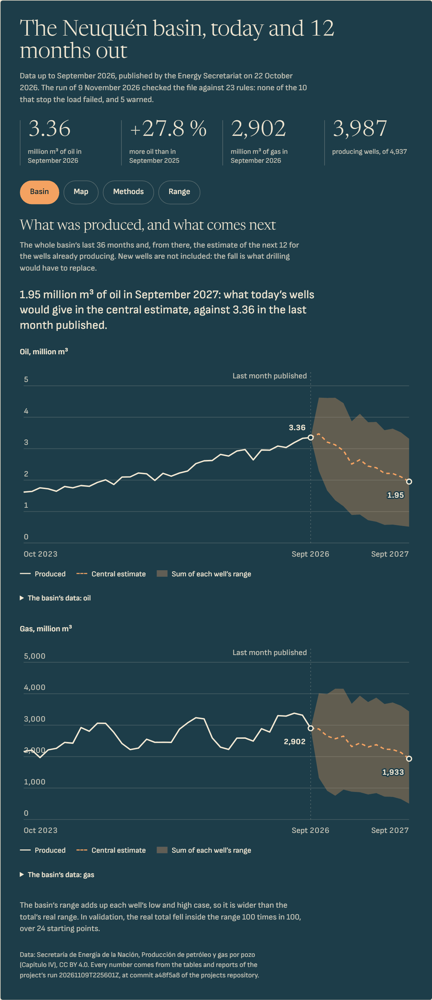
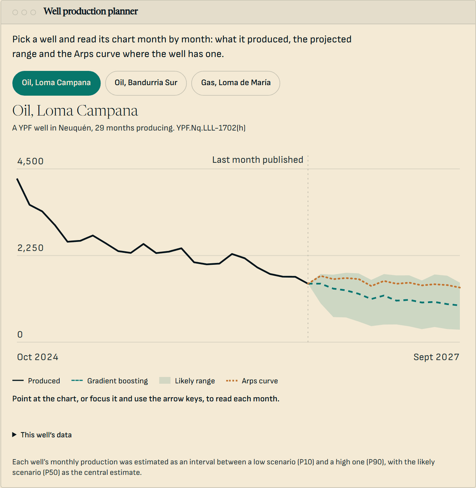
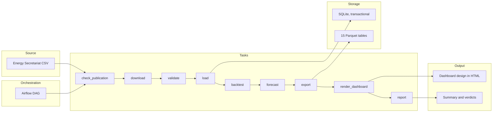

# Production forecasting in the Neuquén basin

**English** · [Español](README.es.md)

A 12-month, well-by-well oil and gas production planner.



|  |  |
| --- | --- |
| **Result** | 2 of 2 success criteria met |
| **Tech stack** | Python, pandas, SciPy, scikit-learn, SQLite, Parquet, Apache Airflow, Docker |
| **Techniques** | Time series, Arps decline curves, Gradient boosting, Quantile regression |
| **To audit** (in Spanish) | [Model card](docs/model-card.md) · [Independent evaluation](docs/evaluation.md) · [Latest run: validation](reports/validation/latest.md) · [Latest run: results](reports/backtest_summary.md) · [Decision log](docs/decisions.md) |

## 1. Executive summary

### 1.1 Business problem and solution

**Business problem and target audience.** Built for the planning teams of oil and gas operators and of service companies that need to anticipate activity levels. The system projects the monthly production of the Neuquén basin’s 4,937 unconventional wells (seven in ten from Vaca Muerta and the rest from formations such as Lajas or Mulichinco) for the next 12 months, grounding investment budgets (CAPEX), gas delivery commitments and decisions on drilling or working over mature wells.

**Proposed solution.** An automated forecasting engine that estimates each well’s future oil and gas path as a calibrated uncertainty interval:

- **Low scenario (P10):** a conservative production bound.
- **Likely scenario (P50):** the central reference estimate.
- **High scenario (P90):** an optimistic production bound.

### 1.2 Success criteria and impact

**Criteria set before measuring.** Before the validation ran, two success criteria were written in config/pipeline.toml: at 12 months, the Arps curve must beat persistence (repeating the last month) in at least 60 % of wells, and the P10–P90 ranges must hold between 70 % and 90 % of the real values.

**Impact and main result.** In retrospective historical validation (backtesting), the intervals from gradient boosting were right in 77 to 79 of every 100 real months measured, bringing the 12-month oil projection error down to 42 %, against 53 % for the traditional Arps curve standard.



## 2. Datasets and preparation

### 2.1 Sources, scope and granularity

- Producción de petróleo y gas por pozo (Capítulo IV). Argentina’s Energy Secretariat, on datos.gob.ar. https://datos.gob.ar/dataset/produccion-de-petroleo-y-gas-por-pozo (CC BY 4.0)

| Attribute | Specification |
| --- | --- |
| Original volume (M × N) | 431,322 rows × 40 columns (a single 149 MB CSV, UTF-8 with BOM) |
| Project scope | 413,865 rows from 4,937 unconventional wells (Neuquén basin) |
| Period covered | 2006 – 2026 (monthly) |
| Granularity and integrity | One row per well and month; primary key (idpozo, anio, mes) with 0 duplicates |
| Selected variables | 34 of 40 columns (the four injection columns, idusuario and vida_util, at 97.9 % nulls, are left out) |

<details>
<summary>Fields available in the dataset (34)</summary>

| Column | Content | Unit | Data type |
| --- | --- | --- | --- |
| `idempresa` | Company code | — | Text |
| `empresa` | Operating company | — | Text |
| `anio` | Year | — | Integer |
| `mes` | Month | — | Integer |
| `idpozo` | Well identifier | — | Integer |
| `sigla` | Well code | — | Text |
| `prod_pet` | Oil production | m³ per month | Decimal |
| `prod_gas` | Gas production | thousand m³ per month | Decimal |
| `prod_agua` | Water production | m³ per month | Decimal |
| `tef` | Effective production days | days | Decimal |
| `tipoextraccion` | Extraction method | — | Text |
| `tipoestado` | Well status | — | Text |
| `tipopozo` | Well type | — | Text |
| `observaciones` | Remarks | — | Text |
| `fechaingreso` | When the row was loaded | — | Date and time |
| `rectificado` | Rectified row | — | Boolean (t/f) |
| `habilitado` | Enabled well | — | Boolean (t/f) |
| `formprod` | Formation code | — | Text |
| `formacion` | Producing formation | — | Text |
| `profundidad` | Depth | m | Decimal |
| `idareapermisoconcesion` | Concession code | — | Text |
| `areapermisoconcesion` | Permit or concession area | — | Text |
| `idareayacimiento` | Field code | — | Text |
| `areayacimiento` | Field | — | Text |
| `cuenca` | Basin | — | Text |
| `provincia` | Province | — | Text |
| `coordenadax` | Longitude | degrees | Decimal |
| `coordenaday` | Latitude | degrees | Decimal |
| `tipo_de_recurso` | Resource type | — | Text |
| `sub_tipo_recurso` | Resource subtype | — | Text |
| `proyecto` | Project | — | Text |
| `clasificacion` | Classification | — | Text |
| `subclasificacion` | Subclassification | — | Text |
| `fecha_data` | Last day of the month reported | — | Date |

</details>

Of the 40 columns, the pipeline uses 34. The four injection columns (water, gas, CO₂ and others), vida_util and idusuario stay out.

### 2.2 Cleaning and quality rules

- **Missing values.** The volume variables have no nulls; the blanks sit in descriptive attributes (observaciones, tipopozo, tipoestado, tipoextraccion and sub_tipo_recurso).
- **Auditable corrections (set to null + flag).** Negative volumes (2 rows), effective days above the month’s calendar days (70 rows) and depths outside the 1–8,000 m range (6,235 rows in 176 wells) are set to null and explicitly flagged on the row. Swapped coordinates are put back (70 rows in 1 well) and those outside the basin are set to null.
- **Kept with a warning.** Rows with zero effective days and reported production are kept (384 rows), with an explicit trace so nothing changes silently.
- **Building the time series.** Each fluid is modelled in its native unit (m³ for oil and water; thousand m³ for gas) as a daily rate (the volume divided by the month’s days), strictly telling a month with no record (missing) from a zero volume (real inactivity).

## 3. Architecture and methodology

The system runs as an end-to-end flow containerised in Docker, made of nine sequential tasks that run identically from the CLI or on a schedule: check_publication → download → validate → load → backtest → forecast → export → render_dashboard → report.

### 3.1 Source and ingestion

- **Change detection (check_publication).** Every day it reads the HTTP headers of the official resource (ETag, modification date and size). If nothing changed since the last accepted load, the run ends without spending resources.
- **Atomic download and integrity (download).** It downloads the whole file into a temporary directory, checks it matches the announced size exactly, renames it atomically and computes its SHA-256 fingerprint for traceability.
- **Quality gate (validate).** It applies 23 business and consistency rules in three levels: blocking (they quarantine the file and abort the flow without touching the production database), warnings (they flag or correct rows) and informational.

### 3.2 Orchestration and transformation

- **Flow control (Apache Airflow).** The oilgas_monthly_production DAG runs the tasks daily, with retries on exponential backoff and a concurrency of one to avoid write locks on SQLite.
- **Transactional transformation (load).** It loads the validated data in a single atomic SQL transaction (all or nothing). The staging layer applies the cleaning rules and audit flags before the dimension and fact tables are built.



### 3.3 Storage and data modelling

- **Transactional and audit database (SQLite).** It holds the validated raw data, the cleaned data with its flags, the run history with each SHA-256, the verdict of each validation rule, the fitted parameters and the historical forecasts.
- **Star-schema analytical layer (Parquet).** The export task writes a star schema of 15 Parquet tables (8 dimensions and 7 fact tables joined by 25 one-to-many relationships with single-direction filtering), embedding in each file’s metadata the run key, the source CSV’s SHA-256 and the CC BY licence attribution.

<details>
<summary>Data model (15 tables)</summary>

| Table | Kind | Columns | Joins |
| --- | --- | --- | --- |
| `Calendar` | dimension | 11 | — |
| `Well` | dimension | 26 | — |
| `Company` | dimension | 2 | — |
| `Fluid` | dimension | 3 | — |
| `Method` | dimension | 6 | — |
| `Horizon` | dimension | 3 | — |
| `Origin` | dimension | 4 | — |
| `Run` | dimension | 14 | — |
| `Monthly production` | fact | 13 | Calendar (`period_key`); Well (`well_key`); Company (`company_key`) |
| `Forecasts` | fact | 14 | Calendar (`target_period_key`); Well (`well_key`); Company (`company_key`); Fluid (`fluid_key`); Method (`method_key`); Horizon (`horizon`); Origin (`origin_period_key`) |
| `Fits per well` | fact | 17 | Well (`well_key`); Fluid (`fluid_key`); Method (`method_key`); Origin (`origin_period_key`) |
| `Fitted curves` | fact | 5 | Calendar (`period_key`); Well (`well_key`); Fluid (`fluid_key`) |
| `Validation metrics` | fact | 17 | Calendar (`origin_period_key`); Fluid (`fluid_key`); Method (`method_key`); Horizon (`horizon`) |
| `Summary per method` | fact | 19 | Fluid (`fluid_key`); Method (`method_key`); Horizon (`horizon`) |
| `Validation rules` | fact | 7 | Run (`run_key`) |

</details>

### 3.4 Experimentation and machine learning

- **Rigour and traceability protocol.** Every technical decision was recorded as an architecture decision record (ADR), with the hyperparameters, seeds, physical bounds and acceptance criteria kept in a single file (config/pipeline.toml) set before the evaluations ran.

#### 3.4.1 Feature engineering and baseline

Gradient boosting describes each well only with what was known up to the origin month: its six latest rates, the 3- and 6-month means and its trend, the peak and the ratio to it, the months since first production and since the peak, the cumulative volumes, the gas-oil ratio and the water share, plus fixed attributes such as coordinates, depth, formation, well type, extraction method and operator. It does not predict the rate but its log change against the mean of the last three months, which puts wells of very different sizes on the same scale.

**Modelling approach: decline curves, machine learning or a comparative approach?** (D01)

- **Selected alternative:** A parallel evaluation of Arps decline curves and machine learning, compared with each other and against a persistence baseline (naive, the last month observed). It quantifies the real marginal value of each technique over a trivial method and sets out under which operating conditions a complex model beats the traditional heuristic.
- **Rejected alternatives:** Arps curves only: Although they are the industry’s interpretive standard through graphical analysis, on their own they set no quantitative threshold of improvement over a naive persistence projection.
- **Rejected alternatives:** Machine learning only: It lacks individual physical interpretability at well level and is limited in extrapolating beyond the time domain observed in training.

#### 3.4.2 Modelling decisions and ablation (ADR)

<details>
<summary>3 decisions, each with what was rejected</summary>

**Choosing the machine learning algorithm** (D08)

- **Selected alternative:** Histogram-based Gradient Boosting with quantile loss (scikit-learn’s HistGradientBoostingRegressor). It estimates the three operating scenarios directly (P10 / low, P50 / likely and P90 / high) under a single architecture. It also handles categorical variables and missing values natively, and trains globally (cross-learning) over the full set of wells, which enables inference on young wells with little production history.
- **Rejected alternatives:** LightGBM: It belongs to the same algorithmic family; adding it would have brought an external dependency with no distinct structural advantage.
- **Rejected alternatives:** Random Forest: It does not optimise quantiles natively, and estimating uncertainty intervals is a central requirement of the problem.
- **Rejected alternatives:** Recurrent neural networks (RNN/LSTM): An oversized architecture, prone to overfitting for a volume of ~6,000 tabular monthly series.
- **Rejected alternatives:** Linear quantile regression: It cannot capture the non-linear interactions between the well’s age, its decline rate and each company’s operating practices.

**Parameters and minimum window for Arps curves** (D06)

- **Selected alternative:** Three functional variants fixed in advance, requiring at least 6 months of decline after the production peak. A 6-month window guarantees two observations for each estimated parameter, avoiding overfitting without excluding the newest wells, which are the main focus of planning (see D07).
- **Rejected alternatives:** Choosing the variant by test-set error: It leaks data from the evaluation into the fit, which makes the comparison between models unfair.
- **Rejected alternatives:** Requiring 12 months of history: It excludes 312 of the 3,728 oil series that already have 6 months of decline, precisely the new wells that matter most to the business.

**Adding completion and fracture variables** (D15)

- **Selected alternative:** Left out of the production model, backed by experimental evidence (see D38). In a controlled ablation study over the same validation pairs, none of the 16 cells evaluated improved and the mean error worsened by 0.7 %.
- **Rejected alternatives:** Adding them straight to the base model: It contaminated the main comparison with low-quality preliminary data (41 % of lateral lengths reported as zero).

</details>

#### 3.4.3 Validation protocol (backtesting)

Retrospective evaluation through rolling-origin time backtesting over the last 24 months of history, training at each cut-off only on the information available up to that date. Gradient boosting had the lowest error at every horizon evaluated, which is why it is the system’s main engine.

### 3.5 Consumption and governance

- **Consumption interfaces.** The Parquet tables feed the interactive web dashboard (HTML/SVG) directly and a data model ready for Power BI.
- **Governance artefacts.** The report task writes the official verdict report (the single source of truth for published metrics), along with the model card (intended use, assumptions, limits and reproducibility) and the technical decision log.
- **Full lineage.** Every published figure stays traceable to the run key, the code commit and the SHA-256 hash of the official source file.

## 4. Final product

### 4.1 Operational deliverables

- **Audited automated pipeline.** Verified in a full run (run 20261109T225601Z of 9 November 2026 on the release of 22 October 2026, commit a48f5a8), passing 10 of 10 blocking rules and logging 5 data-quality warnings.
- **Interactive well-level planner.** It is the planner in the executive summary: a monthly view of one well (for example YPF.Nq.LLL-1702(h) in Loma Campana) that overlays the real production history, gradient boosting’s P10–P90 uncertainty band and the physical Arps fit.
- **Basin executive dashboard.** An aggregate view of the production history (36 months) and a 12-month projection on the existing active wells (with no new wells added), which measures the base decline that new drilling has to replace.

### 4.2 Reading the current results

Production snapshot (data to September 2026 and a 12-month projection):

- **Active wells.** 3,987 wells producing out of 4,937.
- **Oil.** 3.36 million m³ in September 2026 (+27.8 % year on year), with a central projection of 1.95 million m³ for September 2027.
- **Gas.** 2,902 million m³ in September 2026, with a central projection of 1,933 million m³ for September 2027.
- **Aggregate consistency.** In the 24 historical validation cut-offs, the sum of the individual intervals held the basin’s real total in 100 % of cases.

## 5. Conclusion

### 5.1 Evaluation against the success criteria

**Status:** 2 of 2 success criteria met.

The verdict against the two criteria set before measuring, in the executive summary:

- **Beating the baseline (win rate).** At 12 months, the Arps curve fit beat naive persistence in 61.9 % of oil wells and 64.1 % of gas wells, above the 60 % floor required.
- **Uncertainty calibration.** The prediction intervals reached an empirical coverage of 77 % to 81 % of the real values observed, inside the target band (70 % – 90 %), which makes decisions under risk possible.

**12-month comparison (oil)**

| Method evaluated | Cumulative relative error (12 months) | Role in the system |
| --- | --- | --- |
| Gradient boosting (quantile) | 42 % | Main forecasting engine and P10–P90 ranges |
| Arps decline curves | 53 % | Physical, interpretable reference per well |
| Persistence (naive) | 72 % | Minimum control baseline |

### 5.2 Methodological limits

The system shows the technical and operational viability of combining global statistical learning with physical heuristics for oil and gas planning. Its main limit is that the evaluation covered a 24-month backtesting window; abrupt technical, regulatory or macroeconomic regime changes not seen in that period call for continuous drift monitoring and monthly retraining with each new official release.

### 5.3 Future work

- **A scheduled run on a real release.** The full run was tested from the command line, and the Airflow DAG in Docker on a synthetic release; the daily DAG still has to run on the official release.
- **Drift monitoring.** With each new release, compare the month’s error and coverage with the backtesting’s, and alert when they leave the accepted band.
- **Fracture variables.** Repeat the ablation once the fracture file is no longer preliminary: the negative result holds for today’s data.

## Run it

Python 3.11, on PowerShell, from the repository folder:

```powershell
py -3.11 -m venv .venv
.venv\Scripts\python -m pip install -r requirements-dev.txt
$env:PYTHONPATH = "src"

# Tests, without the ones that need the real publication or Docker
.venv\Scripts\python -m pytest -m "not real_data and not docker"

# Quick end-to-end run on synthetic data; everything stays in data\quick\, which is not versioned
.venv\Scripts\python -m oilgas make-fixture data\quick\publication.csv
.venv\Scripts\python -m oilgas run --config config\pipeline.quick.toml

# Real run: downloads the publication (149 MB) and runs the nine tasks
.venv\Scripts\python -m oilgas run

# Optional ablation: machine learning with and without fracture data (about 15 minutes)
.venv\Scripts\python -m oilgas ablation-fracture

# Documentation figures and the results block of README.es.md
.venv\Scripts\python -m oilgas figures
.venv\Scripts\python -m oilgas docs-sync
```

Every operation, with its failures and how to recover, is in the [runbook](docs/runbook.md) (in Spanish).

## Source and licence

Data source: Secretaría de Energía de la Nación (Argentina), «Producción de petróleo y gas por pozo (Capítulo IV)», datos.gob.ar, CC BY 4.0 (https://creativecommons.org/licenses/by/4.0/). Changes: filtered by basin and resource type, records validated, Arps decline curves estimated, and projections and P10/P50/P90 bands calculated.

The raw data is not versioned: the flow downloads it. The well fracture file («Datos de fractura de pozos, adjunto IV») comes from the same body under CC BY 4.0, and its official note calls the data preliminary and subject to review.

The code is under the [MIT licence](LICENSE); the source data keeps the licence given above.
