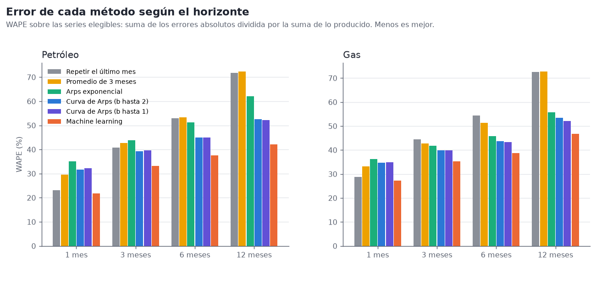
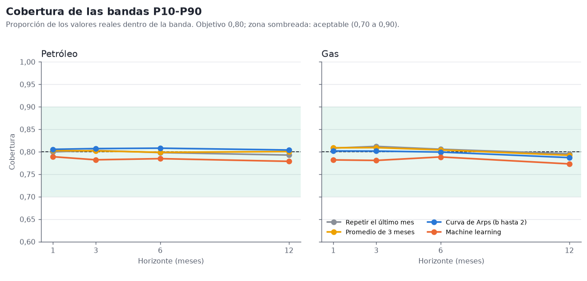
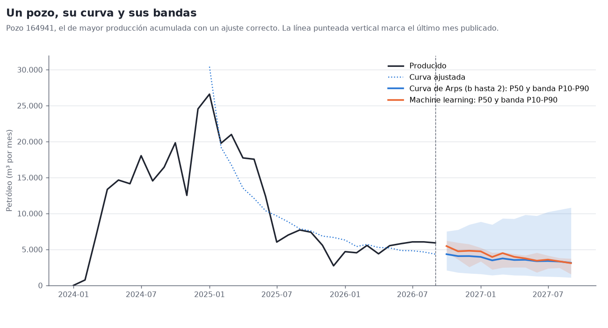
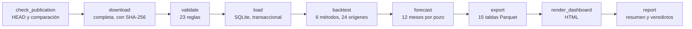

# Producción de petróleo y gas, pozo por pozo

Un flujo automático que toma la publicación mensual de la Secretaría de Energía, la valida, proyecta la producción de cada pozo no convencional de la cuenca Neuquina con curvas de declinación de Arps y con machine learning, y mide con qué error lo hace cada método frente a repetir el último mes.

## El problema

La Secretaría de Energía publica cada mes la producción de cada pozo. El dato es abierto (CC BY 4.0), pero llega crudo: solo para los pozos no convencionales es un CSV de 149 MB con 431.322 filas y 40 columnas, con huecos, meses sin movimiento (el 20,3 % de las filas no tiene petróleo ni gas), valores negativos y republicaciones de meses anteriores.

Quienes lo necesitan son los equipos de planificación de una operadora (presupuestos, compromisos de entrega, capacidad de instalaciones), las empresas de servicios que anticipan actividad y los organismos públicos que proyectan regalías. Hoy cada mes alguien descarga el archivo, lo filtra a mano y rehace las proyecciones en planillas, con criterios que cambian según quién las arma. Y casi nunca se mide cuánto se equivocaron: sin esa medición no se sabe si una curva de declinación es mejor que repetir el último mes.

## La solución

Un flujo que, sin intervención, verifica cada día si hay una publicación nueva, la descarga completa y la valida con 23 reglas; si la acepta, la carga en una base SQL, ajusta una curva de Arps a cada pozo, la compara con un modelo de machine learning y con dos líneas base ingenuas mediante una validación mes a mes (walk-forward) con bandas P10, P50 y P90, y deja las tablas listas para un tablero de Power BI en modelo estrella junto con el diseño del tablero en HTML. Si la publicación está dañada, la rechaza y deja todo lo anterior intacto.

El resultado central no es una curva sino una medición: para cada método, horizonte y fluido, cuánto error tiene y en cuántos pozos le gana a repetir el último mes, con criterios de aceptación fijados antes de mirar los datos.

## Los resultados

Corrida real del 2026-11-09 sobre la publicación del 2026-10-22: 4.937 pozos, 24 orígenes de evaluación (2024-09 a 2026-08), cuatro horizontes (1, 3, 6 y 12 meses) y 2.879.616 pronósticos evaluados. Los criterios de aceptación se fijaron antes de correr nada: la curva de Arps debía superar a repetir el último mes en al menos el 60 % de los pozos a 12 meses, y las bandas P10-P90 debían cubrir entre el 70 % y el 90 % de los valores reales. **Los dos se cumplen**; el bloque siguiente se copia de `reports/backtest_summary.md`, que genera el propio flujo, y dice también lo que no favorece.

<!-- results:start -->
### Curva de Arps frente a repetir el último mes

**Petróleo.** Cumple el criterio fijado de antemano.
- A 12 meses, la curva de Arps supera a repetir el último mes en el 61,88 % de los pozos (umbral: 60 %).
- A 6 meses, el WAPE de la curva de Arps (44,92 %) es menor que el de repetir el último mes (53,04 %).
- A 12 meses, el WAPE de la curva de Arps (52,55 %) es menor que el de repetir el último mes (71,77 %).

**Gas.** Cumple el criterio fijado de antemano.
- A 12 meses, la curva de Arps supera a repetir el último mes en el 64,09 % de los pozos (umbral: 60 %).
- A 6 meses, el WAPE de la curva de Arps (43,73 %) es menor que el de repetir el último mes (54,42 %).
- A 12 meses, el WAPE de la curva de Arps (53,37 %) es menor que el de repetir el último mes (72,6 %).

### Cobertura de las bandas P10-P90

Objetivo 0,80: calibrado entre 0,75 y 0,85, aceptable entre 0,70 y 0,90, descalibrado fuera de ese rango.

- A 1 mes, la cobertura P10-P90 de la curva de Arps en petróleo es 0,81 (objetivo 0,80): calibrado.
- A 1 mes, la cobertura P10-P90 del modelo de machine learning en petróleo es 0,79 (objetivo 0,80): calibrado.
- A 3 meses, la cobertura P10-P90 de la curva de Arps en petróleo es 0,81 (objetivo 0,80): calibrado.
- A 3 meses, la cobertura P10-P90 del modelo de machine learning en petróleo es 0,78 (objetivo 0,80): calibrado.
- A 6 meses, la cobertura P10-P90 de la curva de Arps en petróleo es 0,81 (objetivo 0,80): calibrado.
- A 6 meses, la cobertura P10-P90 del modelo de machine learning en petróleo es 0,78 (objetivo 0,80): calibrado.
- A 12 meses, la cobertura P10-P90 de la curva de Arps en petróleo es 0,80 (objetivo 0,80): calibrado.
- A 12 meses, la cobertura P10-P90 del modelo de machine learning en petróleo es 0,78 (objetivo 0,80): calibrado.
- A 1 mes, la cobertura P10-P90 de la curva de Arps en gas es 0,80 (objetivo 0,80): calibrado.
- A 1 mes, la cobertura P10-P90 del modelo de machine learning en gas es 0,78 (objetivo 0,80): calibrado.
- A 3 meses, la cobertura P10-P90 de la curva de Arps en gas es 0,80 (objetivo 0,80): calibrado.
- A 3 meses, la cobertura P10-P90 del modelo de machine learning en gas es 0,78 (objetivo 0,80): calibrado.
- A 6 meses, la cobertura P10-P90 de la curva de Arps en gas es 0,80 (objetivo 0,80): calibrado.
- A 6 meses, la cobertura P10-P90 del modelo de machine learning en gas es 0,79 (objetivo 0,80): calibrado.
- A 12 meses, la cobertura P10-P90 de la curva de Arps en gas es 0,79 (objetivo 0,80): calibrado.
- A 12 meses, la cobertura P10-P90 del modelo de machine learning en gas es 0,77 (objetivo 0,80): calibrado.

### Aporte del machine learning

- A 1 mes, en petróleo (series elegibles), el modelo de machine learning supera a la curva de Arps (pinball escalada 0,23 frente a 0,36).
- A 3 meses, en petróleo (series elegibles), el modelo de machine learning supera a la curva de Arps (pinball escalada 0,33 frente a 0,45).
- A 6 meses, en petróleo (series elegibles), el modelo de machine learning supera a la curva de Arps (pinball escalada 0,37 frente a 0,52).
- A 12 meses, en petróleo (series elegibles), el modelo de machine learning supera a la curva de Arps (pinball escalada 0,42 frente a 0,61).
- A 1 mes, en petróleo (series jóvenes), el modelo de machine learning supera al promedio de los últimos 3 meses (pinball escalada 0,21 frente a 0,62).
- A 3 meses, en petróleo (series jóvenes), el modelo de machine learning supera al promedio de los últimos 3 meses (pinball escalada 0,33 frente a 0,90).
- A 6 meses, en petróleo (series jóvenes), el modelo de machine learning supera al promedio de los últimos 3 meses (pinball escalada 0,41 frente a 1,00).
- A 12 meses, en petróleo (series jóvenes), el modelo de machine learning supera al promedio de los últimos 3 meses (pinball escalada 0,46 frente a 1,09).
- A 1 mes, en gas (series elegibles), el modelo de machine learning supera a la curva de Arps (pinball escalada 0,27 frente a 0,39).
- A 3 meses, en gas (series elegibles), el modelo de machine learning supera a la curva de Arps (pinball escalada 0,35 frente a 0,46).
- A 6 meses, en gas (series elegibles), el modelo de machine learning supera a la curva de Arps (pinball escalada 0,38 frente a 0,52).
- A 12 meses, en gas (series elegibles), el modelo de machine learning supera a la curva de Arps (pinball escalada 0,45 frente a 0,64).
- A 1 mes, en gas (series jóvenes), el modelo de machine learning supera al promedio de los últimos 3 meses (pinball escalada 0,24 frente a 0,64).
- A 3 meses, en gas (series jóvenes), el modelo de machine learning supera al promedio de los últimos 3 meses (pinball escalada 0,38 frente a 0,92).
- A 6 meses, en gas (series jóvenes), el modelo de machine learning supera al promedio de los últimos 3 meses (pinball escalada 0,42 frente a 0,95).
- A 12 meses, en gas (series jóvenes), el modelo de machine learning supera al promedio de los últimos 3 meses (pinball escalada 0,51 frente a 1,08).

### Tasa de respaldo de las curvas de Arps

- La tasa de respaldo de arps_exp en petróleo llega a 0 % (máximo: 2 %): dentro del máximo.
- La tasa de respaldo de arps_mh_b1 en petróleo llega a 0 % (máximo: 2 %): dentro del máximo.
- La tasa de respaldo de arps_mh_b2 en petróleo llega a 0 % (máximo: 2 %): dentro del máximo.
- La tasa de respaldo de arps_exp en gas llega a 0 % (máximo: 2 %): dentro del máximo.
- La tasa de respaldo de arps_mh_b1 en gas llega a 0 % (máximo: 2 %): dentro del máximo.
- La tasa de respaldo de arps_mh_b2 en gas llega a 0 % (máximo: 2 %): dentro del máximo.

### WAPE por método y horizonte (series elegibles)

**Petróleo.**

| Método | 1 mes | 3 meses | 6 meses | 12 meses |
| --- | ---: | ---: | ---: | ---: |
| arps_exp | 35,02 % | 43,82 % | 51,34 % | 62,1 % |
| arps_mh_b1 | 32,32 % | 39,67 % | 45,04 % | 52,1 % |
| arps_mh_b2 | 31,62 % | 39,24 % | 44,92 % | 52,55 % |
| ml_hgb | 21,85 % | 33,25 % | 37,56 % | 42,18 % |
| naive_last | 23,11 % | 40,89 % | 53,04 % | 71,77 % |
| naive_mean3 | 29,59 % | 42,63 % | 53,42 % | 72,28 % |

**Gas.**

| Método | 1 mes | 3 meses | 6 meses | 12 meses |
| --- | ---: | ---: | ---: | ---: |
| arps_exp | 36,19 % | 41,8 % | 45,88 % | 55,81 % |
| arps_mh_b1 | 34,87 % | 39,88 % | 43,37 % | 52,14 % |
| arps_mh_b2 | 34,77 % | 39,89 % | 43,73 % | 53,37 % |
| ml_hgb | 27,24 % | 35,32 % | 38,77 % | 46,7 % |
| naive_last | 28,75 % | 44,55 % | 54,42 % | 72,6 % |
| naive_mean3 | 33,21 % | 42,78 % | 51,42 % | 72,69 % |

### Método en uso por defecto

| Fluido | Series | Método | Pinball escalada promedio |
| --- | --- | --- | ---: |
| Petróleo | elegibles | ml_hgb | 0,337 |
| Petróleo | jóvenes | ml_hgb | 0,353 |
| Gas | elegibles | ml_hgb | 0,364 |
| Gas | jóvenes | ml_hgb | 0,388 |

Regla: menor pinball escalada promedio en los horizontes 1, 3, 6, 12; en un empate, el método más simple.
<!-- results:end -->

**Cómo leerlo.**

- A 12 meses la curva de Arps le gana a repetir el último mes en el 62 % de los pozos de petróleo y el 64 % de los de gas, y baja el error total (WAPE) de 72 % a 53 %. El margen sobre el umbral es chico en petróleo: 1,9 puntos.
- A 1 mes **no supera** a repetir el último mes (WAPE 31,6 % contra 23,1 % en petróleo; le gana en el 20 % de los pozos), y a 3 meses la ventaja es mínima. La curva empieza a pagar desde los 6 meses.
- El machine learning es el mejor método en todas las celdas (WAPE a 12 meses: 42 % en petróleo y 47 % en gas) y por eso es el método en uso por defecto. Le gana a repetir el último mes en el 72 % y el 74 % de los pozos a 12 meses. Aporta más en los pozos jóvenes, donde la curva de Arps no puede ajustarse.
- Las bandas P10-P90 cubren entre 0,77 y 0,81 de los valores reales (objetivo 0,80). Las del machine learning quedan algo por debajo del objetivo, dentro de «calibrado».
- Los datos de fractura (preliminares) **no mejoran** el machine learning: en una ablación sobre los mismos 506.386 pares no mejoran ninguna de las 16 celdas (cambio medio de la pinball escalada: +0,7 %), con una regla escrita antes de correrla (decisión D38). Quedan fuera del modelo base.
- Lo que sigue pendiente de verificar: una evaluación independiente de estos resultados (ver «Con IA, de punta a punta») y su estabilidad en otras ventanas de tiempo. Todas las celdas, método por método, están en la [ficha del modelo](docs/model-card.md).








## En qué consiste

Nueve tareas que corren siempre en este orden, las mismas desde la línea de comandos (`python -m oilgas run`) y desde el DAG de Apache Airflow (`oilgas_monthly_production`, una vez por día):



La primera tarea corta el flujo si la publicación no cambió; la tercera lo corta, sin tocar nada, si el archivo no cumple el contrato.

## Los datos

| | |
| --- | --- |
| Fuente | Secretaría de Energía de la Nación, «Producción de petróleo y gas por pozo (Capítulo IV)», archivo de pozos no convencionales |
| Publicación usada | 2026-10-22, 148.923.474 bytes, 431.322 filas, 40 columnas, UTF-8 con BOM |
| Subconjunto | cuenca Neuquina, no convencional, toda la historia: 413.865 filas, 4.937 pozos, 52 operadoras, 139 yacimientos, de 2006-01 a 2026-09 |
| Unidades | petróleo y agua en m³, gas en miles de m³, por mes |
| Calidad | 20,3 % de las filas sin petróleo ni gas; 2 gases negativos; 70 filas con más días de extracción que días del mes; 176 pozos con profundidad inválida |
| Aparte | el archivo preliminar de fractura (solo en la ablación, que mostró que no mejora el modelo; decisión D38) |

Cada columna con su unidad está en [docs/data-dictionary.md](docs/data-dictionary.md).

## Los algoritmos

- **Dos líneas base:** repetir el último mes y el promedio de los últimos tres.
- **Curvas de Arps** ajustadas con SciPy: exponencial y dos hiperbólicas modificadas (con declinación terminal del 10 % anual), una con b hasta 2 (caso base, fijado de antemano) y otra con b hasta 1 como sensibilidad.
- **Machine learning:** `HistGradientBoostingRegressor` de scikit-learn con pérdida cuantílica (P10, P50, P90), hiperparámetros fijos.
- **Validación walk-forward:** 36 orígenes mensuales (12 de calentamiento y 24 de evaluación) y horizontes de 1, 3, 6 y 12 meses, con el mismo conjunto de pares para todos los métodos y sin fuga de información, comprobada con pruebas.
- **Bandas:** de los errores ya realizados antes de cada origen para los métodos puntuales; de la regresión cuantílica para el machine learning.

Ecuaciones, límites y advertencias en [docs/model-card.md](docs/model-card.md).

## El producto

- **Tablas para Power BI:** 15 archivos Parquet (8 dimensiones y 7 hechos) en `outputs/powerbi/`, con relaciones uno a varios y filtro en un solo sentido, claves únicas e integridad referencial verificadas.
- **Diseño del tablero:** [dashboard/powerbi-design.html](dashboard/powerbi-design.html), un solo archivo autocontenido con los pasos para armarlo en Power BI Desktop, el diagrama del modelo, las 25 relaciones, las consultas de Power Query, las medidas DAX y cinco páginas con vistas previas dibujadas con los números reales. Armar el `.pbix` requiere la interfaz gráfica de Power BI Desktop y no está hecho: el HTML es el diseño de cómo se haría.
- **Reportes:** `reports/backtest_summary.json` y `.md` (los resultados de arriba) y `reports/validation/latest.md` (la última validación).
- **Orquestación:** CLI y DAG de Airflow sobre Docker Compose.

## La documentación

| Documento | Qué contiene |
| --- | --- |
| [docs/research.md](docs/research.md) | La investigación del dataset y del stack |
| [docs/requirements.md](docs/requirements.md) | Requerimientos, datos medidos y criterios de aceptación |
| [docs/plan.md](docs/plan.md) | Arquitectura, módulos y unidades de trabajo |
| [docs/decisions.md](docs/decisions.md) | Registro de decisiones (D01-D38), con motivo y lo que afecta cada una |
| [docs/data-dictionary.md](docs/data-dictionary.md) | Diccionario de datos con unidades |
| [docs/model-card.md](docs/model-card.md) | Ficha del modelo: métodos, validación, resultados y límites |
| [docs/runbook.md](docs/runbook.md) | Qué hacer ante una publicación atrasada, un cambio de forma, una descarga fallida y más |
| [docs/paso-a-paso.md](docs/paso-a-paso.md) | Cómo se construyó, unidad por unidad |
| [docs/review-advisories.md](docs/review-advisories.md) | Las advertencias de las revisiones nativas, en su texto original |

## Con IA, de punta a punta

Este proyecto lo construyeron agentes de Claude Code, cada uno con el modelo que correspondía a su tarea, con una persona definiendo el rumbo. Lo que sigue es lo que efectivamente pasó, según el registro del proyecto:

- **Bocetos y datos.** Un agente con Haiku investigó el dataset consultando la API del portal y las cabeceras de los CSV. Después un agente con Opus descargó el CSV completo y lo perfiló con scripts de Python desde la terminal (columnas, unidades, huecos, valores imposibles) y bosquejó tres enfoques: solo curvas, solo machine learning, o los dos comparados. Consultó la documentación de Airflow por un servidor MCP (Context7). El archivo lo leyó Python, no un servidor MCP.
- **Decisiones.** Cada decisión de diseño quedó en [docs/decisions.md](docs/decisions.md) con su contexto, las opciones, el motivo y los campos y métricas que afecta. Es un registro enlazado, no un grafo de conocimiento. La decisión de sumar o no el dataset público de fractura, que todavía es preliminar, se resolvió midiendo: una ablación con una regla fijada antes de correrla (D38). La mayoría de las 20 primeras las propuso el agente de planificación mientras el dueño estaba ausente, y queda constancia de cuáles esperan su revisión.
- **Programación.** Un agente con Sonnet construyó cada unidad de trabajo a partir del plan, con la prueba escrita primero y una comprobación de mutación por unidad (romper a propósito la lógica y ver qué prueba lo detecta).
- **Revisión.** La revisión nativa de Gentle AI revisó unidades por separado. Encontró un error real en la carga a la base (un subconjunto vacío borraba la tabla antes de fallar), que se corrigió con la prueba primero, y dejó advertencias que se resolvieron una por una.
- **Memoria.** Engram, un servidor MCP de memoria persistente, guarda el contexto entre sesiones; el documento de seguimiento conserva las palabras del dueño tal cual.
- **Pendiente.** Una evaluación final independiente con un agente de Opus todavía no se hizo. Hasta entonces, lo que respalda los resultados son las pruebas (más de 600), el registro de decisiones y la corrida real descripta arriba.

Cómo fue cada paso, con las horas y los commits, está en [docs/paso-a-paso.md](docs/paso-a-paso.md).

## Para qué sirve

- **Planificación de una operadora:** una proyección a 12 meses por pozo, con banda, para presupuestos y compromisos de entrega, y una medición honesta de cuánto confiar en ella: a 12 meses el error total ronda el 42 % con machine learning y el 53 % con curvas de Arps.
- **Elegir el método:** el proyecto no asume que una curva de declinación sea mejor que repetir el último mes: lo mide. Hoy, a 1 mes conviene repetir el último mes; desde 6 meses, la curva; y en todos los horizontes el machine learning rinde más.
- **Empresas de servicios y organismos públicos:** comparar yacimientos y operadoras con el mismo criterio y proyectar actividad y regalías.
- **Una publicación nueva sin trabajo manual:** el flujo la detecta, la valida y rehace todo; si el archivo cambió de forma o se dañó, lo rechaza sin tocar lo anterior.
- **Para un tablero:** las tablas en estrella y el diseño en HTML dicen cómo armar las cinco páginas en Power BI Desktop.

Lo que no sirve: certificar reservas, proyectar precios o agua, ni anticipar una fractura nueva o un cierre que todavía no ocurrió. Y la proyección de la cuenca suma pozos que hoy están activos, sin pozos nuevos.

## Cómo correrlo de punta a punta

Requisitos: Windows 10 o 11 (o Linux), Python 3.11 y, solo para Airflow, Docker Desktop con 4 GB de memoria como mínimo (8 GB recomendado). No se usa el Python global: el proyecto trae su propio entorno.

```powershell
cd 01-OilGas-Production-Forecast
py -3.11 -m venv .venv
.venv\Scripts\python -m pip install -r requirements-dev.txt
$env:PYTHONPATH = "src"

# Pruebas (sin las que necesitan la publicación real ni Docker)
.venv\Scripts\python -m pytest -m "not real_data and not docker"

# Prueba rápida de punta a punta sobre datos sintéticos (menos de 3 minutos)
.venv\Scripts\python -m oilgas make-fixture $env:TEMP\fixture.csv
# (poner source.local_path en una copia de config\pipeline.quick.toml)
.venv\Scripts\python -m oilgas run --config config\pipeline.quick.toml

# Corrida real: descarga la publicación (149 MB) y corre las nueve tareas
.venv\Scripts\python -m oilgas run
# o, con el archivo ya descargado:
.venv\Scripts\python -m oilgas run --adopt data\raw\produccin-de-pozos-de-gas-y-petrleo-no-convencional.csv

# Ablación opcional: el machine learning con y sin datos de fractura (unos 15 minutos)
.venv\Scripts\python -m oilgas ablation-fracture

# Figuras de la documentación y bloque de resultados del README
.venv\Scripts\python -m oilgas figures
.venv\Scripts\python -m oilgas docs-sync
```

Con Airflow (Docker Compose): `cd airflow`, `copy .env.example .env`, `docker compose build`, `docker compose up airflow-init`, `docker compose up -d`, y la interfaz queda en `http://localhost:8080`. Detalles y qué hacer si algo falla, en [docs/runbook.md](docs/runbook.md).

Medido en una corrida real con la publicación ya descargada (AMD Ryzen 9 5950X de 16 núcleos, 64 GB, Windows 10, 4 procesos): el backtest completo tardó 23,9 minutos y el flujo completo 30,9 minutos, dentro de los topes de 45 y 90 minutos fijados (tabla por tarea en la [ficha del modelo](docs/model-card.md)).

## Paso a paso

El proyecto se construyó en unidades de trabajo, cada una con sus pruebas y su commit: investigación, requerimientos y plan, andamiaje y contrato de datos, detección y descarga, validación, almacén y SQL, series y líneas base, curvas de Arps, backtest con bandas, machine learning, endurecimiento tras las revisiones, resumen y pronóstico, modelo estrella, diseño del tablero, orquestación, corrida real con figuras, documentación y la ablación con fractura. La cronología completa, con lo que se hizo, lo que se probó y lo que salió en cada una, está en [docs/paso-a-paso.md](docs/paso-a-paso.md).

## Fuente y licencia

Fuente de datos: Secretaría de Energía de la Nación, «Producción de petróleo y gas por pozo (Capítulo IV)», datos.gob.ar, licencia CC BY 4.0 (https://creativecommons.org/licenses/by/4.0/). Modificaciones: se filtró por cuenca y tipo de recurso, se validaron registros, se estimaron curvas de declinación de Arps y se calcularon proyecciones y bandas P10/P50/P90.

Los datos crudos no se versionan: el flujo los descarga. El archivo de fractura de pozos (dataset «Datos de fractura de pozos, adjunto IV») es del mismo organismo y también de licencia CC BY 4.0; se describe como preliminar porque su nota oficial dice «datos preliminares sujetos a revisión».
