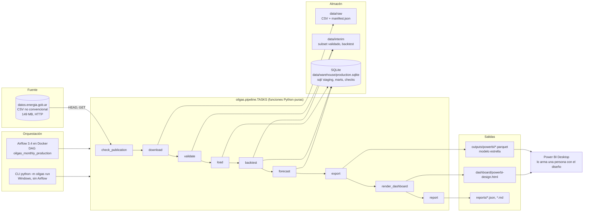

# Plan de implementación: producción de petróleo y gas, pozo por pozo

Fecha: 2026-11-09. Lee primero `requirements.md` (RF, RNF, AC) y `decisions.md` (D01-D20). Este plan dice cómo construirlo; si un detalle no está aquí ni allí, la decisión vuelve a quien planifica: no se adivina. Las suposiciones se marcan como **[Supuesto]** y las cosas que hay que comprobar contra la documentación antes de escribir código, como **[Verificar]**.

Convenciones: documentación en español neutro; código, identificadores, tablas y columnas en inglés; medidas DAX y títulos de visuales en español. Todos los comandos se escriben para Windows (PowerShell) y el `.venv` del proyecto; las rutas son relativas a `01-OilGas-Production-Forecast/`.

## 1. Arquitectura



Principios:

- Cada tarea es una función `fn(ctx: RunContext) -> dict` sin dependencias de Airflow. El DAG y la CLI recorren la misma tupla `TASKS`; el DAG solo la cablea.
- Las tareas se pasan estado por archivos y tablas, nunca por XCom grandes: cada corrida tiene `data/interim/runs/<run_key>.json` con las rutas y los conteos que produjo cada tarea.
- SQLite tiene un solo escritor: el DAG corre con `max_active_runs=1` y `max_active_tasks=1`.
- Las salidas versionadas (Parquet, HTML, reportes) se escriben a un temporal y se renombran con `os.replace`; un rechazo o una falla nunca las deja a medias.

## 2. Estructura de carpetas

```text
01-OilGas-Production-Forecast/
  README.md
  pyproject.toml              # paquete oilgas (src layout), configuración de pytest y marcas
  requirements.txt            # dependencias de ejecución, fijadas con == (U01)
  requirements-dev.txt        # pytest
  .gitignore                  # data/warehouse/, data/interim/, airflow/logs/, airflow/.env, reports/validation/history/
  config/
    pipeline.toml             # configuración completa (sección 4)
    pipeline.quick.toml       # modo rápido para pruebas y desarrollo
  sql/
    schema/001_core.sql       # raw, stg, pipeline_runs, validation_results, load_revisions
    schema/002_model.sql      # model_fit, model_forecast, model_fitted_curve, model_backtest_metrics, model_summary, model_selection
    staging/stg_monthly_production.sql
    marts/production/         # dim_calendar.sql, dim_company.sql, dim_well.sql, fact_production_monthly.sql
    marts/model/              # dim_fluid.sql, dim_method.sql, dim_horizon.sql, dim_origin.sql, fact_forecast.sql,
                              # fact_well_fit.sql, fact_fitted_curve.sql, fact_backtest_metrics.sql,
                              # fact_model_summary.sql, dim_pipeline_run.sql, fact_validation.sql
    checks/                   # chk_*.sql: cada consulta devuelve las filas que violan una regla (0 filas = pasa)
  src/oilgas/
    __init__.py  __main__.py  cli.py  config.py  pipeline.py
    schema.py  ingest.py  validate.py  warehouse.py
    series.py  baselines.py  arps.py  calibration.py  features.py  ml.py
    metrics.py  backtest.py  forecast.py  reporting.py  export.py  figures.py
    dashboard/__init__.py  dashboard/semantic_model.py  dashboard/render.py  dashboard/svg.py
  airflow/
    Dockerfile  docker-compose.yaml  requirements-airflow.txt  .env.example
    dags/oilgas_monthly.py
  dashboard/powerbi-design.html          # generado (versionado)
  outputs/powerbi/*.parquet              # generado (versionado si pesa <= 25 MB)
  reports/backtest_summary.json|.md      # generado (versionado)
  reports/validation/latest.json|.md     # generado (versionado); el historial no
  docs/  research.md requirements.md plan.md decisions.md
         data-dictionary.md model-card.md runbook.md paso-a-paso.md figures/*.png
  tests/
    conftest.py
    fixtures/make_fixture.py  fixtures/real_sample.csv  fixtures/ATTRIBUTION.txt
    unit/  contract/  integration/  e2e/
  data/raw/  data/interim/  data/warehouse/   # nunca versionados
```

Entorno (U01): `py -3.11 -m venv .venv`, luego `.venv\Scripts\python -m pip install -r requirements.txt -r requirements-dev.txt` y `pip check`. Rangos de partida, que U01 reemplaza por las versiones exactas resueltas (`pip freeze`): `numpy>=2.1,<2.5`, `pandas>=2.2.3,<3.0`, `scipy>=1.14,<1.18`, `scikit-learn>=1.6,<1.10`, `pyarrow>=18`, `matplotlib>=3.9,<3.12`; dev: `pytest>=8`. No se usa el Python global: su pyarrow 26 exige NumPy ≥ 2 y su NumPy es 1.26.4, así que scikit-learn no importa (D17). Sin `requests`: la descarga usa `urllib.request`.

Marcas de pytest en `pyproject.toml`: `real_data` (necesita la publicación en `data/raw/`), `docker` (necesita Docker), `slow`. Por defecto: `-m "not real_data and not docker"`.

## 3. Flujo de datos

1. `check_publication`: `HEAD` a la URL; compara `ETag`, `Last-Modified` y tamaño con la última entrada `loaded` del manifiesto. Sin cambios: registra la corrida como `unchanged` (o `late` si el último mes cargado tiene más de 55 días) y corta el flujo.
2. `download`: GET completo en bloques de 1 MiB a `data/raw/<nombre>.part`, SHA-256 al vuelo, verificación de tamaño, `os.replace` al nombre final, entrada `downloaded` en el manifiesto.
3. `validate`: lee el CSV con el contrato, filtra el subconjunto, aplica V01-V20 e I01-I03 contra la carga previa, escribe el reporte. Si hay bloqueantes: cuarentena, corrida `rejected`, excepción `ValidationError` (la tarea falla). Si no: escribe `data/interim/validated_subset.parquet` con nombres en inglés y valores crudos.
4. `load`: en una transacción, calcula revisiones contra `raw_monthly_production` vigente, reemplaza `raw_monthly_production`, reconstruye `stg_monthly_production` y los marts de producción con los SQL, corre `sql/checks/`. Cualquier control con filas aborta la transacción.
5. `backtest`: arma el panel denso de series, corre los métodos puntuales en 36 orígenes y el ML en 24, calibra bandas, escribe `data/interim/backtest/*.parquet` y las métricas agregadas y el resumen en SQLite.
6. `forecast`: origen = último mes publicado; ajusta `arps_mh_b2`, `naive_mean3` y `ml_hgb` para 12 meses, aplica las bandas de los errores del backtest, marca el método elegido, escribe `model_forecast`, `model_fit` y `model_fitted_curve`.
7. `export`: reconstruye los marts del modelo y exporta cada tabla del modelo estrella a Parquet con el esquema de la especificación.
8. `render_dashboard`: genera el HTML del diseño desde la especificación y los Parquet.
9. `report`: escribe `reports/backtest_summary.{json,md}` y `reports/validation/latest.{json,md}`, cierra la corrida como `ok`.

## 4. Configuración

`config/pipeline.toml` (se lee con `tomllib`; las rutas relativas se resuelven contra la carpeta del proyecto; la variable `OILGAS_CONFIG` elige otro archivo y `OILGAS_N_WORKERS` sobrescribe `backtest.n_workers`):

```toml
[source]
mode = "http"                    # "http" o "local" (pruebas y uso sin red)
url = "http://datos.energia.gob.ar/dataset/c846e79c-026c-4040-897f-1ad3543b407c/resource/b5b58cdc-9e07-41f9-b392-fb9ec68b0725/download/produccin-de-pozos-de-gas-y-petrleo-no-convencional.csv"
local_path = ""                  # usado si mode = "local"
package_id = "produccion-de-petroleo-y-gas-por-pozo"
resource_id = "b5b58cdc-9e07-41f9-b392-fb9ec68b0725"
chunk_bytes = 1048576
timeout_s = 120

[scope]
basin = "NEUQUINA"
resource_type = "NO CONVENCIONAL"
first_year = 2006

[validation]
min_rows_ratio = 0.99            # V09
min_wells_ratio = 0.99           # V09
max_unparseable_volume_share = 0.001   # V07
last_period_min_ratio = 0.90     # V11
oil_ceiling_m3 = 30000.0         # V15
gas_ceiling_thousand_m3 = 60000.0      # V15
basin_lon = [-71.5, -66.0]       # V16
basin_lat = [-41.5, -34.5]       # V16
depth_valid_m = [1.0, 8000.0]    # V17
revision_total_tolerance = 0.01  # V20
revision_min_age_months = 3      # V20
freshness_max_days = 55          # RF20

[arps]
min_post_peak_points = 6
terminal_decline_effective_annual = 0.10
di_bounds_per_month = [0.0001, 3.0]
di_bounds_exp_per_month = [0.0001, 1.0]
b_bounds_base = [0.001, 2.0]
b_bounds_sensitivity = [0.001, 1.0]
qi_bound_factor = 5.0            # log_qi en [ln(pico) - ln 5, ln(pico) + ln 5]
b_starts_base = [0.3, 1.0, 1.7]
b_starts_sensitivity = [0.3, 0.8]
loss = "soft_l1"
f_scale = 0.3
max_nfev = 2000

[backtest]
n_eval_origins = 24
n_warmup_origins = 12
eval_horizons = [1, 3, 6, 12]
max_horizon = 12
all_horizon_methods = ["arps_mh_b2", "naive_mean3"]
epsilon_rate = 0.1
calibration_window_origins = 12
min_calibration_samples = 200
n_workers = 4
well_sample = 0                  # 0 = todos los pozos; > 0 = muestra fija con semilla (desarrollo)
seed = 42

[ml]
quantiles = [0.1, 0.5, 0.9]
retrain_every = 3
train_window_months = 60
max_train_rows = 150000
max_iter = 250
learning_rate = 0.06
max_leaf_nodes = 31
min_samples_leaf = 200
l2_regularization = 1.0
seed = 42
top_operators = 15
top_formations = 8
top_extraction_methods = 6

[criteria]                       # preregistrados (AC14-AC16)
share_beats_naive_min = 0.60
share_beats_horizon = 12
wape_horizons = [6, 12]
coverage_target = 0.80
coverage_calibrated = [0.75, 0.85]
coverage_acceptable = [0.70, 0.90]
max_fallback_rate = 0.02

[paths]
raw_dir = "data/raw"
interim_dir = "data/interim"
warehouse = "data/warehouse/production.sqlite"
outputs_dir = "outputs/powerbi"
reports_dir = "reports"
dashboard_html = "dashboard/powerbi-design.html"
readme = "README.md"
```

`config/pipeline.quick.toml` sobrescribe: `source.mode = "local"`, `backtest.n_eval_origins = 6`, `n_warmup_origins = 6`, `n_workers = 1`, `ml.max_iter = 40`, `ml.max_train_rows = 20000`, `ml.retrain_every = 6`, y apunta `paths` a una carpeta temporal cuando la prueba la pasa por parámetro.

## 5. Almacenamiento

SQLite (módulo `sqlite3` de la biblioteca estándar) con archivos SQL versionados en capas `staging → marts` y controles en SQL, ejecutados por un runner Python. Justificación completa en D04: es SQL (landing), no agrega dependencias en Windows, es un solo archivo montable en el contenedor de Airflow y cubre 414 mil filas con funciones de ventana y CTE recursivas. Las capas imitan las convenciones de dbt para que pasar a dbt y BigQuery sea mecánico.

Reglas del runner (`warehouse.py`):

- `connect()` abre con `isolation_level=None` (modo autocommit) y ejecuta `PRAGMA journal_mode=DELETE`, `PRAGMA synchronous=FULL`, `PRAGMA foreign_keys=ON`. Nada de WAL: no funciona bien sobre el montaje de carpetas de Docker Desktop **[Supuesto: verificado en U12 con un escritor único]**.
- Las transacciones son explícitas: `BEGIN IMMEDIATE` … `COMMIT` / `ROLLBACK`.
- **Nunca** `executescript()`: hace un `COMMIT` implícito antes de ejecutar y rompe la transacción. Los archivos SQL se parten en sentencias con `sqlite3.complete_statement` (acumulando líneas) y se ejecutan una por una con `conn.execute`.
- Los marts se reconstruyen con `DROP TABLE IF EXISTS x; CREATE TABLE x AS SELECT …` dentro de la transacción (el DDL de SQLite es transaccional).
- Parámetros con nombre (`:last_period_key`) cuando un SQL los necesita.

Tablas de `sql/schema/001_core.sql` (las claves primarias van entre paréntesis):

- `raw_monthly_production` (`well_id`, `period_key`): las columnas usadas, con nombres en inglés y valores crudos, más `period_index`.
- `stg_monthly_production` (`well_id`, `period_key`): valores corregidos y `quality_flags`.
- `pipeline_runs` (`run_key`): `started_at`, `finished_at`, `status` (`unchanged`, `late`, `rejected`, `failed`, `ok`), `source_url`, `source_etag`, `source_last_modified`, `source_size`, `source_sha256`, `last_period_key`, `rows_subset`, `wells_subset`, `revised_rows`, `message`.
- `validation_results` (`run_key`, `rule_id`): `name_es`, `severity`, `passed`, `rows_affected`, `wells_affected`, `examples_json`.
- `period_totals` (`run_key`, `period_key`): `oil_m3`, `gas_thousand_m3`, `rows` del subconjunto validado (para V20 en la corrida siguiente).
- `load_revisions` (`run_key`, `period_key`): `rows_changed`.

Tablas de `sql/schema/002_model.sql`:

- `model_fit` (`origin_period_key`, `well_id`, `fluid`, `method`): `run_key`, `peak_period_key`, `log_qi`, `qi_rate_per_day`, `di_nominal_per_month`, `b`, `d_lim_nominal_per_month`, `t_switch_months`, `d_effective_annual_initial`, `n_points`, `rmse_log`, `status`.
- `model_forecast` (`origin_period_key`, `well_id`, `fluid`, `method`, `horizon`): `run_key`, `target_period_key`, `company_code`, `p10`, `p50`, `p90` (volúmenes), `segment`, `is_selected`, `fit_status`.
- `model_fitted_curve` (`origin_period_key`, `well_id`, `fluid`, `period_key`): `fitted_volume` (solo `arps_mh_b2`, último origen, meses desde el pico hasta el origen).
- `model_backtest_metrics` (`method`, `fluid`, `horizon`, `origin_period_key`, `age_bucket`, `sub_resource_type`): `run_key`, `n`, `sum_actual`, `sum_p10`, `sum_p50`, `sum_p90`, `sum_abs_error`, `sum_sq_error`, `sum_error`, `n_covered`, `sum_pinball`.
- `model_summary` (`method`, `fluid`, `horizon`, `segment`): `run_key`, `n_series`, `n_points`, `mae`, `rmse`, `wape`, `bias`, `coverage`, `scaled_pinball`, `share_beats_naive_last`, `share_beats_naive_mean3`, `fallback_rate`, `basin_band_coverage`, `coverage_verdict`, `verdict_es`.
- `model_selection` (`fluid`, `segment`): `run_key`, `method`, `criterion_value`, `rule`.

`model_forecast` y `model_fit` acumulan orígenes (una corrida por publicación); volver a correr el mismo origen reemplaza sus filas. Las tablas del backtest se reemplazan enteras en cada backtest.

## 6. Contrato del archivo y validación

`schema.py` define:

- `SOURCE_COLUMNS`: las 40 columnas del encabezado perfilado, en su orden publicado.
- `USED_COLUMNS`: columna de origen → tipo de pandas y nombre en inglés. Renombres: `idempresa→company_code`, `empresa→company_name`, `anio→year`, `mes→month`, `idpozo→well_id`, `sigla→well_code`, `prod_pet→oil_m3`, `prod_gas→gas_thousand_m3`, `prod_agua→water_m3`, `tef→effective_days`, `tipoextraccion→extraction_method`, `tipoestado→well_status`, `tipopozo→well_type`, `observaciones→remarks`, `fechaingreso→loaded_at`, `rectificado→is_rectified`, `habilitado→is_enabled`, `formprod→formation_code`, `formacion→formation_name`, `profundidad→depth_m`, `idareapermisoconcesion→concession_code`, `areapermisoconcesion→concession_name`, `idareayacimiento→field_code`, `areayacimiento→field_name`, `cuenca→basin`, `provincia→province`, `coordenadax→lon`, `coordenaday→lat`, `tipo_de_recurso→resource_type`, `sub_tipo_recurso→sub_resource_type`, `proyecto→project`, `clasificacion→classification`, `subclasificacion→subclassification`, `fecha_data→period_end`. No se usan: `iny_agua`, `iny_gas`, `iny_co2`, `iny_otro`, `vida_util`, `idusuario`.
- `read_source_csv(path) -> pd.DataFrame`: `encoding="utf-8-sig"`, todo como texto primero (`dtype=str`, `keep_default_na=False`, `na_values=[""]`) para que la validación vea los valores tal como vienen; las conversiones de tipo las hace `validate.py` y cuenta lo que no convierte.

Reglas (las cifras entre paréntesis son las de la publicación perfilada). Bloqueantes:

| ID | Regla |
| --- | --- |
| V01 | El archivo se decodifica como UTF-8 (BOM opcional). |
| V02 | Están todas las columnas de `USED_COLUMNS`. |
| V03 | `well_id`, `year` y `month` son enteros y no nulos en todas las filas. |
| V04 | `month` entre 1 y 12; `year` entre `scope.first_year` y el año actual; ningún período posterior al mes actual. |
| V05 | `period_end` es el último día de (`year`, `month`) (0 inconsistencias). |
| V06 | (`well_id`, `year`, `month`) es único en el subconjunto (0 duplicados). |
| V07 | Volúmenes no convertibles o nulos ≤ 0,1 % de las filas (0). |
| V08 | El subconjunto (cuenca y tipo de recurso configurados) no está vacío. |
| V09 | Filas y pozos del subconjunto ≥ 99 % de los de la carga previa. |
| V10 | El último período no es anterior al de la carga previa. |

Advertencias (la fila se corrige en SQL y queda marcada, o solo se marca):

| ID | Regla | Acción en `stg` |
| --- | --- | --- |
| V11 | Filas del último período ≥ 90 % de las del período anterior | Solo reporte; el runbook R5 dice qué hacer |
| V12 | Volumen negativo (2 filas de gas) | A nulo, marca `NEG_VOLUME` |
| V13 | `effective_days` > días del mes (70) | A nulo, marca `TEF_GT_DAYS` |
| V14 | `effective_days = 0` con petróleo o gas > 0 (384) | Se conserva, marca `TEF_ZERO_WITH_PROD` |
| V15 | Petróleo > 30 000 m³ o gas > 60 000 miles de m³ en un mes (0) | Se conserva, marca `VOLUME_CEILING` |
| V16 | Coordenadas intercambiadas (1 pozo) o fuera de la cuenca (0) | Se intercambian o pasan a nulo en `dim_well`, marca por pozo |
| V17 | Profundidad 0 o > 8 000 m (172 + 4 pozos) | A nulo en `dim_well` |
| V18 | Un atributo fijo con más de un valor en un pozo (0) | Se toma el del último período, marca por pozo |
| V19 | Columnas que no están en `SOURCE_COLUMNS` (0) | Solo reporte |
| V20 | Total de la cuenca de un período con más de 3 meses de antigüedad cambió > 1 % respecto de la carga previa | Solo reporte; el detalle por fila lo da `load_revisions` |

Informativas: I01 meses sin producción con estado "Extracción Efectiva"; I02 filas "Cargado automáticamente como [Sin movimientos]" (7 421); I03 meses sin fila dentro del período de un pozo (7 420 meses en 703 pozos).

`ValidationReport` lleva `rows_file`, `rows_subset`, `wells_subset`, `first_period_key`, `last_period_key` y los resultados; el JSON tiene además hasta 5 ejemplos por regla (`well_id`, `period_key`, valor). El Markdown es una tabla en español.

Coherencia (AC06): la cantidad de filas con cada marca en `stg_monthly_production` debe ser igual al `rows_affected` de V12, V13, V14 y V15, y la de pozos marcados en `dim_well`, al `wells_affected` de V16-V18. Hay una prueba de integración para eso.

## 7. SQL

`sql/staging/stg_monthly_production.sql`: une `raw_monthly_production` con los días del mes (`CAST(strftime('%d', date(printf('%04d-%02d-01', year, month), '+1 month', '-1 day')) AS INTEGER)`) y aplica las correcciones de V12-V15 con `CASE`, armando `quality_flags` como texto separado por `;` (vacío si no hay marcas). Agrega `is_producing = (COALESCE(oil_m3,0) > 0 OR COALESCE(gas_thousand_m3,0) > 0)`.

`sql/marts/production/`:

- `dim_calendar.sql`: CTE recursiva desde el primer período hasta el último publicado + 12 meses. Columnas: `period_key`, `period_index`, `month_start` (fecha ISO), `year`, `month`, `month_name_es`, `quarter`, `year_month_label` (`2026-09`), `days_in_month`, `is_published`, `is_last_published`.
- `dim_company.sql`: `company_key` (= `company_code`), `company_name`.
- `dim_well.sql`: una fila por pozo. `well_key`, `well_code`, `province`, `concession_code`, `concession_name`, `field_code`, `field_name`, `formation_code`, `formation_name`, `sub_resource_type`, `basin`, `lon`, `lat`, `depth_m`, `operator_current_key`, `operator_current_name`, `well_type_latest`, `well_status_latest`, `extraction_method_latest`, `first_production_period_key`, `last_report_period_key`, `months_with_production`, `cum_oil_m3`, `cum_gas_thousand_m3`, `cum_water_m3`, `quality_flags` (V16-V18). Los "latest" salen de una ventana `ROW_NUMBER() OVER (PARTITION BY well_id ORDER BY period_key DESC)`.
- `fact_production_monthly.sql`: `well_key`, `period_key`, `company_key`, `oil_m3`, `gas_thousand_m3`, `water_m3`, `effective_days`, `is_producing`, `well_type`, `well_status`, `extraction_method`, `quality_flags`, `run_key`.

`sql/checks/` (cada uno devuelve filas que violan; la carga aborta si alguno devuelve filas):
`chk_stg_unique_key.sql`, `chk_stg_period_range.sql`, `chk_stg_nonnegative.sql`, `chk_stg_effective_days.sql`, `chk_dim_well_unique.sql`, `chk_dim_company_unique.sql`, `chk_dim_calendar_contiguous.sql` (sin huecos de `period_index`), `chk_fact_production_fk_well.sql`, `chk_fact_production_fk_company.sql`, `chk_fact_production_fk_calendar.sql`. Los de la parte del modelo (`chk_forecast_quantiles_ordered.sql`: `p10 <= p50 <= p90`; `chk_forecast_fk.sql`; `chk_backtest_metrics_nonnegative.sql`) corren en `export`.

Revisiones (RF06): antes de reemplazar `raw_monthly_production`, una consulta compara la tabla vigente con el subconjunto nuevo (cargado a una tabla temporal `tmp_raw_new`) por (`well_id`, `period_key`) para los períodos ≤ al último período previo, y cuenta las filas en las que algún volumen difiere más de 1e-6 o que desaparecieron. El total va a `pipeline_runs.revised_rows` y el detalle por período a `load_revisions`.

## 8. Series

`series.py` arma un panel denso: 4 937 pozos × 249 períodos (2006-01 a 2026-09) por fluido, unos 10 MB por arreglo `float64`. El panel hace trivial evitar la fuga: todo cálculo en el origen `o` usa `arr[:, :o_col + 1]`.

- Tasa por día calendario: `rate = volume / days_in_month`. Un mes sin fila es `NaN`; un mes con volumen 0 es 0; los volúmenes corregidos a nulo son `NaN`.
- Pico en el origen: el máximo de las tasas positivas con columna ≤ origen. Si un pozo vuelve a tener un pico mayor (reestimulación), el segmento empieza en el pico nuevo.
- Segmento posterior al pico: meses desde el pico hasta el origen con tasa > 0; `t` = meses calendario desde el pico (los meses en cero o sin fila no entran al ajuste pero el tiempo sigue corriendo; D06).
- Actividad: hay alguna tasa > 0 en las columnas [o − 2, o].
- Segmento de la serie en el origen: `eligible` si está activa y tiene ≥ 6 puntos posteriores al pico (pico incluido); `young` si está activa y tiene menos; `inactive` si no está activa (no se evalúa).
- Tramo de edad: `young` (< 6 puntos), `06-11`, `12-23`, `24-59`, `60+`.

## 9. Métodos

### 9.1 Líneas base (`baselines.py`)

- `naive_last`: tasa del último mes con fila dentro de [o − 2, o] (puede ser 0) × días del mes objetivo, igual para todos los horizontes.
- `naive_mean3`: promedio de las tasas con fila en [o − 2, o] (los ceros cuentan) × días del mes objetivo.

### 9.2 Arps (`arps.py`)

Tasa `q` en m³/d o miles de m³/d; tiempo `t` en meses; declinaciones nominales por mes. Se ajusta el logaritmo de la tasa.

- Exponencial: `ln q(t) = ln qi − Di·t`.
- Hiperbólica: `ln q(t) = ln qi − (1/b)·ln(1 + b·Di·t)`.
- Hiperbólica modificada: hiperbólica hasta `t_s` y exponencial con `D_lim` después. `D_lim = −ln(1 − 0,10) / 12 = 0,0087800` por mes (10 % efectivo anual, D06). `t_s = (Di/D_lim − 1)/(b·Di)` si `Di > D_lim`; si no, `t_s = 0` y la curva es exponencial con `Di`. Para `t > t_s`: `ln q = ln q_s − D_lim·(t − t_s)`, con `ln q_s` la hiperbólica evaluada en `t_s`. Usar `np.log1p` y calcular ambas ramas con `np.where` (la forma medida en el benchmark).
- Declinación efectiva anual inicial que se informa: hiperbólica `1 − (1 + 12·b·Di)^(−1/b)`; exponencial `1 − exp(−12·Di)`.

Variantes: `arps_exp` (Di en [1e-4, 1,0]), `arps_mh_b2` (caso base: Di en [1e-4, 3,0], b en [0,001, 2,0]) y `arps_mh_b1` (sensibilidad: b en [0,001, 1,0]). `ln qi` en [ln(pico) − ln 5, ln(pico) + ln 5]. La variante base está preregistrada: no se elige la variante por pozo mirando el error de prueba.

Ajuste (`fit_series`): `scipy.optimize.curve_fit(f, t, ln_rate, p0, bounds, method="trf", loss="soft_l1", f_scale=0.3, max_nfev=2000)`. Puntos de partida: `ln qi0 = ln(tasa en el pico)`; `pendiente` de `np.polyfit` sobre los primeros min(12, n) puntos; `Di0 = clip(−pendiente·1,5, 0,01, 2,0)` (exponencial: `clip(−pendiente, 0,001, 0,9)`); `b0` en `b_starts_base` o `b_starts_sensitivity`. Si hay parámetros del origen anterior para la misma serie, el mismo método y el mismo pico, se prueban primero (recortados a los límites) junto con un solo `b0 = 1,0`. Gana la solución con menor suma de cuadrados en escala logarítmica. Medido: 3,45 ms por solución, unos 10 ms por serie con tres partidas.

Fallas y respaldo: `RuntimeError`, `ValueError`, `np.linalg.LinAlgError` o parámetros no finitos descartan esa partida. Si fallan todas, la cadena es `arps_mh_b2 → arps_exp → naive_mean3` (y `arps_mh_b1 → arps_exp → naive_mean3`); el `status` queda `ok`, `fallback_exp` o `fallback_naive`. La tasa de respaldo se informa por método (umbral 2 %, AC13). Un ajuste con `rmse_log > 1,0` no se descarta: se marca en `fact_well_fit` para revisión.

Pronóstico: para el horizonte `h`, `t = (o − pico) + h`; volumen = `exp(ln q(t)) × días del mes objetivo`.

### 9.3 Machine learning (`features.py`, `ml.py`)

`HistGradientBoostingRegressor(loss="quantile", quantile=α)` de scikit-learn, uno por fluido × horizonte × cuantil (α = 0,1; 0,5; 0,9), con `max_iter=250`, `learning_rate=0.06`, `max_leaf_nodes=31`, `min_samples_leaf=200`, `l2_regularization=1.0`, `early_stopping=False`, `random_state=42`, `categorical_features="from_dtype"` **[Verificar en la documentación de la versión fijada]**. Hiperparámetros fijos y preregistrados: no hay búsqueda (D08).

Objetivo: `y = ln((r[t+h] + ε) / (m3[t] + ε))`, con `r` la tasa del mes objetivo, `m3` el promedio de las tasas de [t − 2, t] y ε = 0,1. Los meses objetivo en cero entran (dan valores muy negativos; la pérdida cuantílica los tolera). Predicción: `volumen_α = max((m3[o] + ε)·exp(ŷ_α) − ε, 0) × días del mes objetivo`; luego se ordenan los tres cuantiles por fila para que P10 ≤ P50 ≤ P90.

Variables en el mes `t` (todas con datos ≤ t):

- Numéricas: `log_rate_lag0` … `log_rate_lag5` (`log1p` de la tasa), `log_mean3`, `log_mean6`, `decline_3` = `ln((m3[t]+ε)/(m3[t−3]+ε))`, `decline_6`, `log_peak_rate`, `ratio_to_peak` = `ln((m3[t]+ε)/(pico+ε))`, `months_since_first`, `months_since_peak`, `zero_months_last6`, `log_cum_oil`, `log_cum_gas`, `log_gor` = `ln((m3_gas+ε)/(m3_oil+ε))`, `water_cut_mean3` = agua/(petróleo+agua) en [t−2, t], `target_month` (1-12, del mes objetivo: el gas cae cada septiembre), `lon`, `lat`, `depth_m`.
- Categóricas (`category` de pandas): `sub_resource_type`, `formation` (8 más frecuentes + `other`), `well_type_at_t`, `extraction_method_at_t` (6 + `other`), `operator_at_t` (15 + `other`). Los niveles salen de los datos de entrenamiento de cada reentrenamiento; un nivel desconocido pasa a `other`.

Ejemplos de entrenamiento para el origen `o` y el horizonte `h`: todas las (serie, t) activas en `t` con fila en `t + h`, `t + h ≤ o` y `t + h ≥ o − 59` (ventana de 60 meses), con una muestra fija (semilla 42) de hasta 150 000 filas. Se entrena con todos los pozos a la vez, jóvenes incluidos.

Comparación justa con Arps (D08, D10):

- mismo conjunto de pares (serie, origen, horizonte), mismos valores reales, mismas métricas;
- variables solo con datos ≤ origen; objetivos de entrenamiento ≤ origen;
- los métodos puntuales se reajustan en cada origen; el ML se reentrena cada 3 orígenes de evaluación y usa en cada origen el último modelo entrenado con datos ≤ ese origen, con variables calculadas en el origen (así se usaría en producción);
- además, el ML se informa en las series jóvenes, donde Arps no ajusta: ahí se ve "cuándo suma algo".

## 10. Walk-forward y bandas

Con `L` = `period_index` del último mes publicado:

- Orígenes de evaluación: L − 24 … L − 1 (2024-09 a 2026-08 con la publicación perfilada). Calentamiento: L − 36 … L − 25 (2023-09 a 2024-08).
- Horizontes de evaluación 1, 3, 6 y 12; solo cuando `o + h ≤ L`. Celdas por horizonte: 24, 22, 19 y 13 orígenes.
- Métodos puntuales en los 36 orígenes; `arps_mh_b2` y `naive_mean3` en todos los horizontes 1-12 (los necesita el pronóstico en uso), los demás en los cuatro de evaluación. `ml_hgb` solo en los orígenes de evaluación y los cuatro horizontes.
- Par evaluado: serie activa en el origen y con fila en el mes objetivo (un 0 real cuenta). Segmento `eligible` para la comparación principal (los 6 métodos); `young` para `naive_last`, `naive_mean3` y `ml_hgb`.
- Escala estimada: unos 5 600 pares elegibles por origen en promedio, sumando petróleo y gas (de 4 609 en 2023-09 a 6 803 en 2026-08; ver la tabla de `requirements.md`), unos 200 000 pares (serie, origen) en total para Arps, con 16-20 ms por par para las tres variantes: unos 60 min en un proceso, unos 15 min con 4 procesos.

Paralelismo: `concurrent.futures.ProcessPoolExecutor` con `n_workers`; los pozos se parten en `n_workers × 4` grupos; cada proceso recibe su rebanada del panel (arreglos NumPy) y recorre pozo → fluido → orígenes en orden (para el arranque en caliente). Funciones de trabajo en el nivel del módulo y guarda `if __name__ == "__main__"` en la CLI (Windows usa `spawn`). El resultado se ordena por (`fluid`, `well_id`, `origin`, `method`, `horizon`): el backtest da lo mismo con 1 y con 2 procesos (AC22).

Bandas de los métodos puntuales (`calibration.py`, D09): error realizado en escala logarítmica de la tasa, `e = ln((r_real + ε)/(r_P50 + ε))`. Para el origen `o` y el horizonte `h`, el conjunto de calibración son los errores de los orígenes `o'` con `o' + h ≤ o` y `o' ≥ o − h − 11` (los 12 orígenes más recientes con objetivo ya conocido), por (método, fluido, horizonte, tramo de edad); si hay menos de 200 errores en la celda, se usa (método, fluido, horizonte). `P10 = max((r_P50 + ε)·exp(Q₀.₁(e)) − ε, 0)` y `P90` igual con `Q₀.₉`, convertidos a volumen. P50 no se corrige: sigue siendo la curva. Los 12 orígenes de calentamiento existen para que el primer origen de evaluación ya tenga errores a 12 meses.

Bandas del ML: los tres modelos cuantílicos.

Almacenamiento: `data/interim/backtest/point_forecasts.parquet`, `ml_forecasts.parquet` y `errors.parquet` (columnas `float32` y categóricas; varios millones de filas; nunca se versionan). Las métricas agregadas van a `model_backtest_metrics`.

## 11. Métricas, resumen y selección

`metrics.py`, sobre volúmenes en la unidad del fluido (nunca se mezclan fluidos):

- `mae`, `rmse`, `wape = Σ|y − ŷ| / Σy` (la métrica relativa; MAPE no sirve con meses en cero), `bias = Σ(ŷ − y)/Σy`, `coverage = media de 1[P10 ≤ y ≤ P90]`.
- Pinball: `ρ_α(u) = max(α·u, (α − 1)·u)`; `scaled_pinball = Σ_filas Σ_α ρ_α(y − q_α) / Σy`.
- `share_beats(method, baseline)`: por serie y horizonte, el MAE del método sobre sus orígenes de evaluación es estrictamente menor que el de la línea base; proporción sobre las series.
- `basin_band_coverage`: por método, fluido y horizonte, la proporción de orígenes en los que el total real de la cuenca cae entre la suma de los P10 y la suma de los P90 de las series evaluadas.

`model_backtest_metrics` guarda solo componentes sumables (`n`, sumas de real, de P10/P50/P90, de error absoluto, cuadrático y con signo, cubiertos, pinball) en el grano método × fluido × horizonte × origen × tramo de edad × subtipo, para que las medidas DAX agreguen bien con cualquier filtro.

`reporting.evaluate_criteria()` calcula, por fluido, los booleanos preregistrados de AC14-AC16 con los umbrales de `[criteria]` y redacta `verdict_es` con plantillas fijas, por ejemplo: "A 12 meses, la curva de Arps supera a repetir el último mes en el 64 % de los pozos (umbral: 60 %)." o "… no supera a repetir el último mes: lo hace en el 48 % de los pozos (umbral: 60 %).". La cobertura se clasifica como `calibrado`, `aceptable` o `descalibrado`. Nunca se omite un resultado desfavorable.

Selección (RF15, D11): por fluido y segmento, el método con menor `scaled_pinball` promedio sobre los horizontes 1, 3, 6 y 12. Candidatos: `eligible` → `arps_mh_b2`, `ml_hgb`, `naive_mean3`; `young` → `ml_hgb`, `naive_mean3`. Empate: gana el más simple (`naive_mean3`, luego `arps_mh_b2`, luego `ml_hgb`).

`reports/backtest_summary.md` es el bloque de resultados del README: `python -m oilgas docs-sync` lo copia entre `<!-- results:start -->` y `<!-- results:end -->`, y una prueba verifica que el README y el resumen coinciden (AC14-AC16). El DAG no toca el README.

## 12. Pronóstico en uso

`forecast.run_production_forecast(ctx)` con origen `L`:

- Series activas en `L`. `eligible`: `arps_mh_b2` (con su cadena de respaldo), `naive_mean3` y `ml_hgb`. `young`: `naive_mean3` y `ml_hgb`.
- Horizontes 1-12. El ML entrena 12 modelos por fluido y cuantil (72 en total) con objetivos ≤ L. Los horizontes intermedios (2, 4, 5, 7-11) no se validaron en el backtest: la ficha del modelo lo dice.
- Bandas de los métodos puntuales con los errores del backtest de los 12 orígenes más recientes con objetivo ≤ L.
- `is_selected` según `model_selection`.
- `company_code` = operadora del pozo en `L`.
- `model_fit` guarda los parámetros de las tres variantes de Arps en `L`; `model_fitted_curve`, la curva de `arps_mh_b2` en los meses del segmento ajustado.

## 13. Salidas: modelo estrella

Parquet en `outputs/powerbi/`, una tabla por archivo con el mismo nombre (`dim_well.parquet`, …), esquema Arrow explícito tomado de la especificación y metadatos `oilgas.run_key`, `oilgas.source_sha256`, `oilgas.attribution` (texto CC BY 4.0 de `research.md`). Power BI los lee con `Parquet.Document` (D05).

Dimensiones (clave en negrita):

| Tabla | Columnas |
| --- | --- |
| `dim_calendar` | **`period_key`** int32, `period_index` int32, `month_start` date, `year`, `month`, `month_name_es`, `quarter`, `year_month_label`, `days_in_month`, `is_published` bool, `is_last_published` bool |
| `dim_well` | **`well_key`** int64 y las columnas de la sección 7 |
| `dim_company` | **`company_key`** string, `company_name` |
| `dim_fluid` | **`fluid_key`** (`oil`, `gas`), `fluid_name_es` (Petróleo, Gas), `unit` (m³, miles de m³) |
| `dim_method` | **`method_key`** (`naive_last`, `naive_mean3`, `arps_exp`, `arps_mh_b2`, `arps_mh_b1`, `ml_hgb`), `method_name_es`, `family` (línea base, Arps, machine learning), `description_es`, `is_base` bool, `sort_order` |
| `dim_horizon` | **`horizon`** int32 (1-12), `horizon_label` ("1 mes", "3 meses" …), `is_headline` bool (1, 3, 6, 12) |
| `dim_origin` | **`origin_period_key`** int32, `origin_label`, `is_latest` bool, `run_key` |
| `dim_pipeline_run` | **`run_key`** y las columnas de `pipeline_runs` |

Hechos:

| Tabla | Grano | Columnas |
| --- | --- | --- |
| `fact_production_monthly` | pozo × mes | ver sección 7 (≈ 414 mil filas) |
| `fact_forecast` | pozo × fluido × método × origen × horizonte | `well_key`, `fluid_key`, `method_key`, `origin_period_key`, `target_period_key`, `horizon`, `company_key`, `p10`, `p50`, `p90`, `segment`, `is_selected`, `fit_status`, `run_key` (≈ 280 mil filas por origen) |
| `fact_well_fit` | pozo × fluido × método × origen | parámetros de `model_fit` |
| `fact_fitted_curve` | pozo × fluido × mes (último origen) | `well_key`, `fluid_key`, `period_key`, `origin_period_key`, `fitted_volume` |
| `fact_backtest_metrics` | método × fluido × horizonte × origen × tramo × subtipo | componentes sumables (≈ 11 mil filas) |
| `fact_model_summary` | método × fluido × horizonte × segmento | métricas, proporciones, veredicto |
| `fact_validation` | corrida × regla | `run_key`, `rule_id`, `name_es`, `severity` (`bloqueante`, `advertencia`, `informativa`), `status` (`pasa`, `falla`, `advierte`), `rows_affected`, `wells_affected` |

Relaciones: todas uno a varios (1:*), filtro unidireccional de la dimensión al hecho, activas. No hay relaciones bidireccionales ni inactivas.

| ID | Dimensión (1) | Hecho (*) |
| --- | --- | --- |
| R01 | `dim_calendar[period_key]` | `fact_production_monthly[period_key]` |
| R02 | `dim_calendar[period_key]` | `fact_forecast[target_period_key]` |
| R03 | `dim_calendar[period_key]` | `fact_fitted_curve[period_key]` |
| R04 | `dim_calendar[period_key]` | `fact_backtest_metrics[origin_period_key]` |
| R05-R08 | `dim_well[well_key]` | `fact_production_monthly`, `fact_forecast`, `fact_well_fit`, `fact_fitted_curve` |
| R09-R10 | `dim_company[company_key]` | `fact_production_monthly`, `fact_forecast` |
| R11-R15 | `dim_fluid[fluid_key]` | `fact_forecast`, `fact_well_fit`, `fact_fitted_curve`, `fact_backtest_metrics`, `fact_model_summary` |
| R16-R19 | `dim_method[method_key]` | `fact_forecast`, `fact_well_fit`, `fact_backtest_metrics`, `fact_model_summary` |
| R20-R21 | `dim_origin[origin_period_key]` | `fact_forecast`, `fact_well_fit` |
| R22-R24 | `dim_horizon[horizon]` | `fact_forecast`, `fact_backtest_metrics`, `fact_model_summary` |
| R25 | `dim_pipeline_run[run_key]` | `fact_validation` |

`dim_calendar` se marca como tabla de fechas con `month_start`. La jerarquía geográfica vive dentro de `dim_well` (Provincia → Concesión → Yacimiento → Pozo): estrella, no copo de nieve. La operadora va en los hechos porque cambia en el tiempo (979 pozos); `dim_well[operator_current_name]` es solo un atributo.

Versionado: se versionan todos los Parquet de `outputs/powerbi/` mientras cada uno pese ≤ 25 MB (prueba en U10). Si `fact_forecast` lo supera al acumular orígenes, se exportan los últimos 12 orígenes y el resto queda en SQLite.

## 14. Diseño del tablero (HTML)

`dashboard/semantic_model.py` es la única fuente de verdad: tablas, columnas (tipo, descripción, unidad), relaciones, medidas y páginas. De ahí salen el esquema de los Parquet, la tabla del diccionario de datos y el HTML. `dashboard/render.py` genera `dashboard/powerbi-design.html`, autocontenido (CSS y SVG en línea, sin JavaScript externo ni fuentes remotas), con estas secciones:

1. Cómo armarlo en Power BI Desktop: pasos numerados (parámetro `CarpetaSalidas`, una consulta por tabla, relaciones, marcar la tabla de fechas, tabla vacía `_Medidas`, medidas, páginas).
2. Diagrama del modelo en SVG: dimensiones alrededor, hechos al centro, cada relación con "1" y "*" y la flecha del filtro.
3. Tabla de relaciones R01-R25 (cardinalidad, dirección, columnas).
4. Power Query por tabla: `let Origen = Parquet.Document(File.Contents(CarpetaSalidas & "\fact_production_monthly.parquet")) in Origen` **[Verificar en Power BI Desktop; alternativa: el conector Parquet de "Obtener datos"]**.
5. Medidas DAX con formato y descripción.
6. Las cinco páginas a escala 16:9 sobre una grilla de 12 columnas, cada visual ubicado con su tipo, título, campos y una vista previa en SVG con datos reales (líneas y barras de los Parquet).
7. Atribución CC BY 4.0 y la fecha y el `run_key` de los datos.

Medidas (todas en `_Medidas`; las de pronóstico se generan por fluido y cuantil con una plantilla en Python):

```dax
Petróleo producido (m³) = SUM ( fact_production_monthly[oil_m3] )
Gas producido (miles de m³) = SUM ( fact_production_monthly[gas_thousand_m3] )
Agua producida (m³) = SUM ( fact_production_monthly[water_m3] )
Pozos en producción = CALCULATE ( DISTINCTCOUNT ( fact_production_monthly[well_key] ), fact_production_monthly[is_producing] = TRUE () )
Filas por mes = COUNTROWS ( fact_production_monthly )
Petróleo año anterior (m³) =
    VAR periodos = VALUES ( dim_calendar[period_index] )
    RETURN CALCULATE ( [Petróleo producido (m³)], REMOVEFILTERS ( dim_calendar ),
        TREATAS ( SELECTCOLUMNS ( periodos, "p", dim_calendar[period_index] - 12 ), dim_calendar[period_index] ) )
Variación interanual petróleo (%) = DIVIDE ( [Petróleo producido (m³)] - [Petróleo año anterior (m³)], [Petróleo año anterior (m³)] )
Petróleo P50 (m³) =
    VAR origen = IF ( ISFILTERED ( dim_origin[origin_period_key] ),
        SELECTEDVALUE ( dim_origin[origin_period_key] ),
        CALCULATE ( MAX ( dim_origin[origin_period_key] ), REMOVEFILTERS ( dim_origin ) ) )
    RETURN CALCULATE ( SUM ( fact_forecast[p50] ), dim_fluid[fluid_key] = "oil",
        fact_forecast[is_selected] = TRUE (), dim_origin[origin_period_key] = origen )
-- Igual: Petróleo P10 (m³), Petróleo P90 (m³), Gas P10/P50/P90 (miles de m³);
-- y las variantes "por método" sin el filtro is_selected, para comparar métodos en la página Pozo.
Curva ajustada petróleo (m³) = CALCULATE ( SUM ( fact_fitted_curve[fitted_volume] ), dim_fluid[fluid_key] = "oil" )
Curva ajustada gas (miles de m³) = CALCULATE ( SUM ( fact_fitted_curve[fitted_volume] ), dim_fluid[fluid_key] = "gas" )
WAPE (%) = DIVIDE ( SUM ( fact_backtest_metrics[sum_abs_error] ), SUM ( fact_backtest_metrics[sum_actual] ) )
MAE = DIVIDE ( SUM ( fact_backtest_metrics[sum_abs_error] ), SUM ( fact_backtest_metrics[n] ) )
RMSE = SQRT ( DIVIDE ( SUM ( fact_backtest_metrics[sum_sq_error] ), SUM ( fact_backtest_metrics[n] ) ) )
Sesgo (%) = DIVIDE ( SUM ( fact_backtest_metrics[sum_error] ), SUM ( fact_backtest_metrics[sum_actual] ) )
Cobertura P10-P90 (%) = DIVIDE ( SUM ( fact_backtest_metrics[n_covered] ), SUM ( fact_backtest_metrics[n] ) )
Objetivo de cobertura = 0.8
Pinball escalada = DIVIDE ( SUM ( fact_backtest_metrics[sum_pinball] ), SUM ( fact_backtest_metrics[sum_actual] ) )
WAPE línea base (%) = CALCULATE ( [WAPE (%)], REMOVEFILTERS ( dim_method ), dim_method[method_key] = "naive_last" )
Mejora frente a la línea base (%) = 1 - DIVIDE ( [WAPE (%)], [WAPE línea base (%)] )
Error del total de la cuenca (%) = DIVIDE ( ABS ( SUM ( fact_backtest_metrics[sum_p50] ) - SUM ( fact_backtest_metrics[sum_actual] ) ), SUM ( fact_backtest_metrics[sum_actual] ) )
Series que superan a la línea base (%) = AVERAGE ( fact_model_summary[share_beats_naive_last] )
Veredicto = SELECTEDVALUE ( fact_model_summary[verdict_es] )
Último mes publicado = CALCULATE ( MAX ( dim_pipeline_run[last_period_key] ), dim_pipeline_run[status] = "ok" )
Reglas bloqueantes fallidas = CALCULATE ( COUNTROWS ( fact_validation ), fact_validation[severity] = "bloqueante", fact_validation[status] = "falla" )
```

La suma de P10 (o P90) de varios pozos no es el P10 del total: es el P10 si todos los pozos se movieran juntos y es más ancha que la verdadera si son independientes. Los visuales agregados la rotulan "Suma de P10 por pozo" y la ficha del modelo informa su cobertura real a nivel de cuenca (`basin_band_coverage`, D19).

Páginas (grilla de 12 columnas; posición x, y, ancho, alto en celdas):

1. **Cuenca**. Segmentadores arriba: Provincia, Empresa, Yacimiento, Subtipo, Formación, Período. Tarjetas: Petróleo y Gas del último mes, Variación interanual, Pozos en producción, Último mes publicado. Gráfico de líneas "Petróleo: producido y proyectado (m³)" (eje `dim_calendar[month_start]`; producido, P50, P10 y P90 punteadas); el mismo para gas. Barras "10 empresas con más petróleo, últimos 12 meses". Dispersión "Pozos" con `dim_well[lon]` y `dim_well[lat]`, tamaño por petróleo de 12 meses, color por subtipo (no necesita un servicio de mapas). Texto de atribución.
2. **Empresas y yacimientos**. Matriz empresa × año (petróleo, gas). Mapa de árbol por yacimiento. Tabla: yacimiento, pozos en producción, petróleo de 12 meses, P50 de los próximos 12 meses, variación.
3. **Pozo**. Segmentador de `dim_well[well_code]` con búsqueda. Tarjetas de atributos. Líneas: producido, curva ajustada, P10/P50/P90 por método (eje Y logarítmico opcional). Tarjetas `qi`, `Di`, `b`, declinación efectiva anual inicial, estado del ajuste. Tabla de los últimos 24 meses y los 12 proyectados.
4. **Validación del modelo**. Segmentadores: fluido, horizonte, segmento, origen. Columnas agrupadas: WAPE por método y horizonte. Líneas: cobertura por horizonte y método con la línea constante del objetivo 0,8. Barras: series que superan a la línea base. Matriz método × tramo de edad (WAPE). Tarjeta: veredicto. Líneas: WAPE por origen.
5. **Calidad y frescura**. Tarjetas: último mes publicado, días desde el fin de ese mes, estado de la última corrida, reglas bloqueantes fallidas. Tabla de reglas (severidad, filas, estado). Líneas: filas por mes. Tabla de corridas.

## 15. Orquestación

`pipeline.py`:

```python
@dataclass(frozen=True)
class TaskSpec:
    task_id: str
    func: Callable[[RunContext], dict]
    retries: int
    retry_delay_min: int
    timeout_min: int
    short_circuit: bool = False

TASKS: tuple[TaskSpec, ...] = (
    TaskSpec("check_publication", check_publication, 3, 10, 5, short_circuit=True),
    TaskSpec("download", download, 3, 15, 30),
    TaskSpec("validate", validate, 0, 0, 15),
    TaskSpec("load", load, 1, 5, 20),
    TaskSpec("backtest", backtest, 1, 10, 120),
    TaskSpec("forecast", forecast, 1, 10, 45),
    TaskSpec("export", export, 1, 5, 10),
    TaskSpec("render_dashboard", render_dashboard, 1, 5, 10),
    TaskSpec("report", report, 1, 5, 5),
)
```

DAG `airflow/dags/oilgas_monthly.py` (Airflow 3: `from airflow.sdk import DAG, task`; verificado en la documentación de Airflow 3.1; **[Verificar]** `task.short_circuit` contra 3.4.0 con Context7 antes de escribirlo):

- `dag_id="oilgas_monthly_production"`, `schedule="0 9 * * *"` (todos los días a las 06:00 de Argentina), `start_date` 2026-11-01 UTC, `catchup=False`, `max_active_runs=1`, `max_active_tasks=1`, `default_args` con `retry_exponential_backoff=True`, `tags=["oilgas"]`.
- Recorre `TASKS` en orden, crea una tarea por `TaskSpec` (con `task.short_circuit` si corresponde) con sus reintentos y su `execution_timeout`, y las encadena con `>>`. Cada tarea llama a `pipeline.run_task(task_id, run_id)`; la de corte devuelve `bool(result["changed"])`. Cuidado con la clausura dentro del bucle: pasar `task_id` como argumento por defecto.
- Programación diaria y no mensual (D12): la verificación es un `HEAD` barato, una publicación tardía se toma el mismo día que aparece y una republicación con otro ETag se recarga entera.

Idempotencia: `run_key` deriva del `run_id` de Airflow (o de la hora UTC en la CLI). La huella de la publicación (ETag, Last-Modified, tamaño, SHA-256) solo queda `loaded` en el manifiesto cuando `report` termina; si una corrida falla a mitad, la siguiente la rehace entera. Cada tarea reemplaza por clave lo que escribe.

Publicación tardía (RF20): `check_publication` calcula los días entre hoy y el fin del último período cargado; si superan 55, registra la corrida como `late` aunque no haya cambios. **[Supuesto: 55 días sale de una sola observación, archivo del 2026-10-22 con datos hasta 2026-09; ajustar con las publicaciones siguientes]**.

Cambio de forma: una columna faltante o renombrada falla en V02 → `rejected`, cuarentena, la tarea `validate` falla y el resto no corre; almacén y salidas quedan como estaban. El runbook (R2) explica cómo agregar un renombre al contrato con su accesorio de prueba.

Docker (`airflow/`):

- `Dockerfile`: `FROM apache/airflow:3.4.0`, `COPY requirements-airflow.txt /`, `RUN pip install --no-cache-dir "apache-airflow==${AIRFLOW_VERSION}" -r /requirements-airflow.txt` (el patrón de la documentación oficial para no cambiar la versión de Airflow). `requirements-airflow.txt` lista las mismas librerías de `requirements.txt` con rangos, no con `==`, para respetar las restricciones de Airflow.
- `docker-compose.yaml`: partir del oficial `https://airflow.apache.org/docs/apache-airflow/3.4.0/docker-compose.yaml`, cambiar a `LocalExecutor` y quitar `redis`, `airflow-worker` y `flower` para bajar la memoria **[Verificar que el archivo de 3.4.0 funciona así; si no, usar el oficial sin cambios]**; `build: .` en lugar de la imagen; montar la carpeta del proyecto en `/opt/oilgas` y `./dags`; variables `PYTHONPATH=/opt/oilgas/src`, `OILGAS_CONFIG=/opt/oilgas/config/pipeline.toml`, `OILGAS_N_WORKERS=2`, `AIRFLOW__CORE__LOAD_EXAMPLES=false`.
- `.env.example`: `AIRFLOW_UID=50000`.
- Para el dueño: `cd airflow`, `copy .env.example .env`, `docker compose build`, `docker compose up airflow-init`, `docker compose up -d`, interfaz en `http://localhost:8080`. Docker necesita 4 GB como mínimo (8 GB recomendado).

CLI (`cli.py`, `__main__.py`):

```text
python -m oilgas run [--config RUTA] [--adopt RUTA_CSV] [--only TAREA ...] [--from TAREA]
python -m oilgas task TAREA [--run-key CLAVE]
python -m oilgas figures          # docs/figures/*.png con matplotlib
python -m oilgas docs-sync        # resultados al README; tabla de tablas al diccionario de datos
python -m oilgas make-fixture SALIDA.csv [--wells 60] [--seed 0]
```

## 16. Módulos y funciones públicas

Las firmas son el contrato con las pruebas; los detalles internos quedan a criterio de quien programa.

```python
# config.py
@dataclass(frozen=True)
class PipelineConfig: source: SourceConfig; scope: ScopeConfig; validation: ValidationConfig
    arps: ArpsConfig; backtest: BacktestConfig; ml: MLConfig; criteria: CriteriaConfig; paths: PathsConfig
def load_config(path: Path | None = None, overrides: Path | None = None) -> PipelineConfig

# ingest.py
@dataclass(frozen=True)
class RemoteMeta: url: str; etag: str | None; last_modified: str | None; size: int | None
@dataclass(frozen=True)
class ManifestEntry: url: str; etag: str | None; last_modified: str | None; size: int; sha256: str
    local_path: str; downloaded_at: str; status: Literal["downloaded", "loaded", "rejected"]; run_key: str
def head_remote(url: str, timeout_s: int) -> RemoteMeta
def local_meta(path: Path) -> RemoteMeta                    # source.mode = "local": tamaño y mtime
def read_manifest(path: Path) -> list[ManifestEntry]
def last_loaded(entries: list[ManifestEntry]) -> ManifestEntry | None
def is_changed(remote: RemoteMeta, last: ManifestEntry | None) -> bool
def download_file(url: str, dest: Path, expected_size: int | None, chunk_bytes: int, timeout_s: int) -> tuple[Path, str]
def adopt_local_file(path: Path, remote: RemoteMeta, run_key: str) -> ManifestEntry
def append_manifest(path: Path, entry: ManifestEntry) -> None
def mark_manifest(path: Path, run_key: str, status: str) -> None
def quarantine(path: Path, quarantine_dir: Path, sha256: str) -> Path

# schema.py
SOURCE_COLUMNS: tuple[str, ...]; USED_COLUMNS: dict[str, tuple[str, str]]   # origen -> (nombre en inglés, tipo)
def read_source_csv(path: Path) -> pd.DataFrame

# validate.py
class Severity(StrEnum): BLOCKING = "blocking"; WARNING = "warning"; INFO = "info"
@dataclass(frozen=True)
class RuleResult: rule_id: str; name_es: str; severity: Severity; passed: bool
    rows_affected: int; wells_affected: int; examples: list[dict]
@dataclass(frozen=True)
class PreviousLoad: rows_subset: int; wells_subset: int; last_period_key: int; period_totals: pd.DataFrame
@dataclass(frozen=True)
class ValidationReport: run_key: str; source_sha256: str; rows_file: int; rows_subset: int; wells_subset: int
    first_period_key: int; last_period_key: int; results: list[RuleResult]
    @property
    def blocking_failed(self) -> bool: ...
class ValidationError(RuntimeError): ...
def validate_file(path: Path, cfg: PipelineConfig, previous: PreviousLoad | None, run_key: str, today: date) -> tuple[ValidationReport, pd.DataFrame | None]
def write_report(report: ValidationReport, out_dir: Path) -> tuple[Path, Path]

# warehouse.py
@dataclass(frozen=True)
class CheckResult: check_id: str; violations: int; sample: list[tuple]
@dataclass(frozen=True)
class LoadResult: rows: int; wells: int; last_period_key: int; revised_rows: int; checks: list[CheckResult]
def connect(path: Path) -> sqlite3.Connection
def split_statements(sql_text: str) -> list[str]
def run_sql_file(conn: sqlite3.Connection, path: Path, params: Mapping[str, object] | None = None) -> None
def apply_schema(conn: sqlite3.Connection) -> None
def load_validated_subset(conn: sqlite3.Connection, frame: pd.DataFrame, run_key: str) -> LoadResult
def run_checks(conn: sqlite3.Connection, group: Literal["production", "model"]) -> list[CheckResult]
def previous_load(conn: sqlite3.Connection) -> PreviousLoad | None
def record_run(conn: sqlite3.Connection, run: dict) -> None

# series.py
FLUIDS = ("oil", "gas")
@dataclass(frozen=True)
class SeriesPanel: well_ids: np.ndarray; period_index: np.ndarray; days_in_month: np.ndarray
    volume: dict[str, np.ndarray]; rate: dict[str, np.ndarray]; water_rate: np.ndarray
    attrs: pd.DataFrame; period_codes: dict[str, np.ndarray]   # categorías que cambian por mes, como códigos
def build_panel(conn: sqlite3.Connection, well_sample: int = 0, seed: int = 42) -> SeriesPanel
def column_of(panel: SeriesPanel, period_index: int) -> int
def peak_column(rate_row: np.ndarray, upto: int) -> int | None
def post_peak_points(rate_row: np.ndarray, upto: int) -> tuple[np.ndarray, np.ndarray]
def segment_at(rate_row: np.ndarray, upto: int, min_points: int) -> Literal["eligible", "young", "inactive"]
def age_bucket(n_post_peak: int) -> str

# baselines.py
def naive_last(rate_row: np.ndarray, upto: int, target_days: np.ndarray) -> np.ndarray
def naive_mean3(rate_row: np.ndarray, upto: int, target_days: np.ndarray) -> np.ndarray

# arps.py
D_LIM_DEFAULT: float
@dataclass(frozen=True)
class ArpsParams: method: str; log_qi: float; di: float; b: float; d_lim: float; t_switch: float
@dataclass(frozen=True)
class FitResult: params: ArpsParams | None; status: Literal["ok", "fallback_exp", "fallback_naive"]
    n_points: int; rmse_log: float
def nominal_from_effective_annual(d_eff_annual: float) -> float
def switch_time(di: float, b: float, d_lim: float) -> float
def exponential_log_rate(t: np.ndarray, log_qi: float, di: float) -> np.ndarray
def hyperbolic_log_rate(t: np.ndarray, log_qi: float, di: float, b: float) -> np.ndarray
def modified_hyperbolic_log_rate(t: np.ndarray, log_qi: float, di: float, b: float, d_lim: float) -> np.ndarray
def fit_series(t: np.ndarray, rate: np.ndarray, method: str, cfg: ArpsConfig, warm_start: ArpsParams | None = None) -> FitResult
def predict_rate(params: ArpsParams, t: np.ndarray) -> np.ndarray
def effective_annual_initial(params: ArpsParams) -> float

# calibration.py
def log_error(actual_rate: np.ndarray, p50_rate: np.ndarray, eps: float) -> np.ndarray
def calibration_pool(errors: pd.DataFrame, origin: int, horizon: int, window: int) -> pd.DataFrame
def band_quantiles(errors: pd.DataFrame, origin: int, cfg: BacktestConfig) -> pd.DataFrame
def apply_bands(p50_rate: np.ndarray, q10: np.ndarray, q90: np.ndarray, eps: float) -> tuple[np.ndarray, np.ndarray]

# features.py
NUMERIC_FEATURES: tuple[str, ...]; CATEGORICAL_FEATURES: tuple[str, ...]
def features_at(panel: SeriesPanel, fluid: str, col: int, rows: np.ndarray | None = None, horizon: int = 1) -> pd.DataFrame
def training_examples(panel: SeriesPanel, fluid: str, horizon: int, origin_col: int, cfg: MLConfig, eps: float) -> tuple[pd.DataFrame, np.ndarray]

# ml.py
def fit_quantile_models(X: pd.DataFrame, y: np.ndarray, cfg: MLConfig) -> dict[float, HistGradientBoostingRegressor]
def predict_volumes(models: dict, X: pd.DataFrame, base_rate: np.ndarray, target_days: np.ndarray, eps: float) -> np.ndarray  # (n, 3) ordenado

# metrics.py
def mae(y, yhat) -> float; def rmse(y, yhat) -> float; def wape(y, yhat) -> float; def bias(y, yhat) -> float
def coverage(y, lo, hi) -> float; def pinball(y, q, alpha) -> np.ndarray; def scaled_pinball(y, p10, p50, p90) -> float
def additive_components(frame: pd.DataFrame, by: list[str]) -> pd.DataFrame
def share_beats(frame: pd.DataFrame, method: str, baseline: str) -> pd.DataFrame

# backtest.py
POINT_METHODS = ("naive_last", "naive_mean3", "arps_exp", "arps_mh_b2", "arps_mh_b1")
@dataclass(frozen=True)
class BacktestPlan: warmup_origins: list[int]; eval_origins: list[int]; last_index: int
def plan_origins(last_index: int, cfg: BacktestConfig) -> BacktestPlan
def run_point_methods(panel: SeriesPanel, plan: BacktestPlan, cfg: PipelineConfig) -> pd.DataFrame
def add_empirical_bands(point: pd.DataFrame, plan: BacktestPlan, cfg: BacktestConfig) -> pd.DataFrame
def run_ml(panel: SeriesPanel, plan: BacktestPlan, cfg: PipelineConfig) -> pd.DataFrame
def run_backtest(ctx: RunContext) -> dict

# forecast.py
def run_production_forecast(ctx: RunContext) -> dict

# reporting.py
def summarize(forecasts: pd.DataFrame, cfg: PipelineConfig) -> pd.DataFrame
def evaluate_criteria(summary: pd.DataFrame, cfg: CriteriaConfig) -> dict
def select_methods(summary: pd.DataFrame) -> pd.DataFrame
def render_results_markdown(criteria: dict, summary: pd.DataFrame) -> str
def write_summary(criteria: dict, summary: pd.DataFrame, reports_dir: Path) -> tuple[Path, Path]
def sync_block(path: Path, start_marker: str, end_marker: str, content: str) -> bool

# export.py
def build_model_marts(conn: sqlite3.Connection) -> None
def export_star_schema(conn: sqlite3.Connection, out_dir: Path, model: SemanticModel, run_key: str, source_sha256: str, attribution: str) -> list[Path]

# dashboard/semantic_model.py
@dataclass(frozen=True)
class Column: name: str; dtype: str; description_es: str; unit: str | None = None
@dataclass(frozen=True)
class Table: name: str; kind: Literal["dimension", "fact"]; key: tuple[str, ...]; columns: tuple[Column, ...]
@dataclass(frozen=True)
class Relationship: rel_id: str; dim_table: str; dim_column: str; fact_table: str; fact_column: str
    cardinality: str = "one_to_many"; cross_filter: str = "single"; active: bool = True
@dataclass(frozen=True)
class Measure: name_es: str; dax: str; format_string: str; description_es: str
@dataclass(frozen=True)
class Visual: kind: str; title_es: str; fields: tuple[str, ...]; x: int; y: int; w: int; h: int
@dataclass(frozen=True)
class Page: name_es: str; visuals: tuple[Visual, ...]
@dataclass(frozen=True)
class SemanticModel: tables: tuple[Table, ...]; relationships: tuple[Relationship, ...]
    measures: tuple[Measure, ...]; pages: tuple[Page, ...]
MODEL: SemanticModel
def dax_column_refs(dax: str) -> set[tuple[str, str]]
def arrow_schema(table: Table) -> pa.Schema

# dashboard/render.py, dashboard/svg.py
def render_design(model: SemanticModel, outputs_dir: Path, html_path: Path, attribution: str) -> Path
def line_chart(series: dict[str, list[tuple[float, float]]], width: int, height: int, title: str) -> str
def bar_chart(values: list[tuple[str, float]], width: int, height: int, title: str) -> str

# pipeline.py
@dataclass(frozen=True)
class RunContext: cfg: PipelineConfig; run_key: str; started_at: datetime; state_path: Path
TASKS: tuple[TaskSpec, ...]
def make_run_key(source: str | datetime) -> str
def run_task(task_id: str, run_id: str | None = None, cfg: PipelineConfig | None = None) -> dict
def run_all(cfg: PipelineConfig, adopt: Path | None = None, only: list[str] | None = None, start: str | None = None) -> list[dict]

# figures.py
def make_figures(conn: sqlite3.Connection, reports_dir: Path, out_dir: Path) -> list[Path]
```

Accesorios de prueba (`tests/fixtures/make_fixture.py`): `make_fixture(path, n_wells=60, first=(2018, 1), last=(2024, 12), seed=0) -> FixtureTruth` escribe un CSV con BOM y las 40 columnas en el orden publicado, pozos con hiperbólicas modificadas de parámetros conocidos y ruido lognormal, ceros, huecos, un gas negativo, un `tef` mayor que los días del mes, un pozo con coordenadas intercambiadas, dos cambios de operadora, pozos shale y tight, y algunos pozos jóvenes. `make_malformed(base, kind, out) -> Path` con `kind` en `missing_column`, `renamed_column`, `non_numeric_well_id`, `month_13`, `duplicate_key`, `bad_period_end`, `truncated`, `regressed_last_period`, `not_utf8`. `real_sample.csv`: los 5 pozos con más meses de historia entre los shale de petróleo elegibles, con su historia completa, sacados de la publicación real en U01 (los `idpozo` elegidos quedan escritos en `ATTRIBUTION.txt` junto con la atribución CC BY 4.0).

## 17. Documentación

README del proyecto, con estos títulos de segundo nivel y en este orden (AC23):

```text
# Producción de petróleo y gas, pozo por pozo
## El problema
## La solución
## Los resultados          (bloque generado entre <!-- results:start --> y <!-- results:end -->)
## En qué consiste
## Los datos
## Los algoritmos
## El producto
## La documentación
## Con IA, de punta a punta
## Para qué sirve
## Cómo correrlo de punta a punta
## Paso a paso
## Fuente y licencia
```

El resto del conjunto, en `docs/`:

- `data-dictionary.md`: las 40 columnas de origen (nombre en inglés, unidad, significado y si está verificado o inferido, según `research.md` y este perfilado) y una tabla por Parquet exportado generada desde la especificación entre marcadores (`docs-sync`). La prueba exige que cada columna de cada Parquet esté documentada con su unidad (o "—").
- `model-card.md`: uso previsto y no previsto (no sirve para certificar reservas), datos, métodos con las ecuaciones y los límites, diseño del backtest, resultados (del resumen), bandas y la advertencia de la suma de P10, limitaciones (el backtest usa los datos ya revisados, no las versiones de cada mes; tiempo calendario; cierres; cambios de operadora; fractura fuera; horizontes intermedios del ML sin validar; estacionalidad del gas).
- `decisions.md`: este registro, actualizado con los resultados.
- `runbook.md`: R1 publicación atrasada, R2 cambio de forma, R3 republicación de meses anteriores, R4 descarga fallida o tamaño distinto, R5 archivo truncado o último mes incompleto, R6 muchas fallas de ajuste, R7 bandas descalibradas, R8 Airflow no arranca (memoria de Docker, puerto 8080), R9 `database is locked`, R10 reconstrucción desde cero, R11 la URL del recurso cambió (cómo encontrarla con `package_show` de CKAN).
- `paso-a-paso.md`: cronología real, desde la investigación hasta la corrida final, una sección por unidad de trabajo con lo que se hizo, qué se probó y qué salió; se escribe con el registro del documento de seguimiento y `git log`.
- `figures/`: `example_well_fit.png` (historia, curva y bandas de un pozo), `method_comparison.png` (WAPE por método y horizonte), `coverage.png` (cobertura frente a 0,8), `basin_forecast.png` (cuenca: producido y proyectado). Con matplotlib.

## 18. "Con IA, de punta a punta", contado como fue

El README cuenta el proceso real a partir del registro del documento de seguimiento (`odd/tasks/portfolio-projects.md`), sin afirmar herramientas que no figuren ahí:

- **Investigación**: un agente de Claude Code con Haiku consultó la API CKAN, las cabeceras HTTP y las primeras líneas de los CSV, y escribió `research.md`.
- **Requerimientos y plan**: un agente con Opus descargó el CSV completo, lo perfiló con scripts de Python desde la terminal, comparó tres enfoques (solo curvas, solo machine learning, los dos comparados), midió el costo de un ajuste y escribió `requirements.md`, `plan.md` y `decisions.md`. (Una versión anterior decía que consultó la documentación de Airflow por el servidor MCP Context7; el registro no lo respalda y se quitó, D43.)
- **Programación**: un agente con Sonnet construyó cada unidad de trabajo con sus pruebas a partir de este plan.
- **Evaluación**: un agente con Opus verificó los resultados de forma independiente; la revisión nativa de Gentle AI revisó los cambios de riesgo.
- **Memoria y contexto**: Engram (servidor MCP de memoria persistente) guarda el contexto entre sesiones; el documento de seguimiento guarda las palabras del dueño tal cual.

Lo que dice hoy el sitio y lo que corresponde (para que el dueño decida el texto; S9):

| Paso del sitio | Lo que dice | Lo que pasó | Texto propuesto |
| --- | --- | --- | --- |
| Bocetos | "Un agente lee los CSV a través de un servidor MCP, perfila columnas, unidades y huecos, y bosqueja tres enfoques" | El agente leyó el CSV con Python desde la terminal, no por MCP; el MCP que consta en el registro es la memoria (Engram; la mención a Context7 se quitó, D43); sí perfiló y sí comparó tres enfoques (D01) | "Un agente descarga y perfila el CSV completo con Python (columnas, unidades, huecos) y bosqueja tres enfoques: solo curvas, solo machine learning, o los dos comparados." |
| Decisiones | "Un grafo de conocimiento une cada campo, cada métrica y cada decisión con su motivo … La persona decide y el grafo guarda el porqué." | Hay un registro de decisiones con identificadores, motivo y los campos y métricas que afecta; no un grafo. La mayoría de las decisiones las propuso el agente de planificación mientras el dueño estaba ausente; la de fractura queda para el dueño | Opción A (recomendada): generar `docs/decision-graph.md` (Mermaid) y `docs/decision-graph.json` desde las líneas "Afecta" de `decisions.md` (unas 120 líneas con su prueba, en U14), y el texto queda casi igual. Opción B: "Un registro de decisiones enlaza cada campo y cada métrica con su motivo…". |
| Producto final | "Agentes escriben las pruebas del flujo, los controles de volúmenes y la documentación a partir del grafo, mientras la persona revisa cada proyección." | Un agente escribió pruebas, controles y documentación a partir del plan y del registro; un agente evaluador verificó; la persona revisa al final, no cada proyección | "…a partir del plan y del registro de decisiones, mientras un agente evaluador verifica cada resultado y la persona revisa el conjunto." |

Otras diferencias con el sitio que hay que llevar al sitio cuando estén los números: el sitio dice "Cada pozo del país" y el proyecto cubre los 4 937 pozos no convencionales de la cuenca Neuquina (96,0 % de las filas del archivo no convencional); el dato "1 CSV por año" describe el dataset, pero el proyecto usa un solo CSV con todos los años; los resultados (WAPE, cobertura, proporción de pozos) salen de `reports/backtest_summary.json`.

## 19. Unidades de trabajo

Cada unidad termina con sus pruebas en verde (`.venv\Scripts\python -m pytest -m "not real_data and not docker"`), un commit convencional y la casilla del documento de seguimiento marcada por quien orquesta. Las líneas son estimaciones (código + pruebas), no topes. Requisito previo de cada unidad: leer `requirements.md`, este plan y `decisions.md` hasta el final.

| Unidad | Qué entrega | Archivos | Pruebas | Criterios | Líneas |
| --- | --- | --- | --- | --- | --- |
| U01 Andamiaje y contrato | `.venv`, `requirements*.txt` fijados, `pyproject.toml`, `.gitignore`, `config/*.toml`, `config.py`, `schema.py`, generador de accesorios, `real_sample.csv` | `src/oilgas/{__init__,config,schema}.py`, `tests/fixtures/*`, `tests/conftest.py` | configuración (valores, sobrescrituras, variables de entorno), contrato de 40 columnas, lectura de `real_sample.csv` (BOM, tildes) | parte de AC03 | ~380 |
| U02 Detección y descarga | `ingest.py`, modo local | `src/oilgas/ingest.py` | servidor HTTP local en un hilo (HEAD con ETag, GET, tamaño distinto, 404), manifiesto, adopción, cuarentena | AC01, AC02 | ~350 |
| U03 Validación | `validate.py` con V01-V20 e I01-I03, reportes | `src/oilgas/validate.py` | cada accesorio malformado da su regla; el válido da 0 bloqueantes; recuentos de V12-V15 sobre el accesorio | AC03 | ~450 |
| U04 Almacén y SQL | `sql/schema`, `sql/staging`, `sql/marts/production`, `sql/checks`, `warehouse.py` | `sql/**`, `src/oilgas/warehouse.py` | carga del accesorio, controles en 0, idempotencia, revisiones, coherencia con la validación, `split_statements` | AC05, AC06 | ~450 |
| U05 Series, líneas base y métricas | `series.py`, `baselines.py`, `metrics.py` | esos tres | pico, segmentos, tramos, líneas base a mano, métricas a mano, `share_beats` | AC10 | ~380 |
| U06 Arps | `arps.py` | `src/oilgas/arps.py` | AC07-AC09 sobre curvas sintéticas, límites, respaldo | AC07, AC08, AC09 | ~400 |
| U07 Backtest y bandas | `calibration.py`, `backtest.py` (métodos puntuales, paralelismo, intermedios, métricas a SQLite) | esos dos | perturbación posterior al origen, conjunto de calibración ≤ origen, cobertura sintética, 1 vs 2 procesos | AC11, AC12, AC22 | ~450 |
| U08 Machine learning | `features.py`, `ml.py`, integración en el backtest | esos dos y `backtest.py` | variables sin fuga, objetivos ≤ origen, cuantiles ordenados, reentrenamiento cada 3 orígenes | AC11 | ~420 |
| U09 Resumen, selección y pronóstico | `reporting.py`, `forecast.py` | esos dos | veredictos con resúmenes sintéticos favorables y desfavorables, regla de selección y desempates, filas del pronóstico, `sync_block` | AC14-AC16 (lógica) | ~420 |
| U10 Modelo estrella | `sql/marts/model`, `export.py`, `dashboard/semantic_model.py` | esos | claves únicas, integridad referencial, relaciones 1:* unidireccionales, esquema Arrow, referencias DAX, tamaño ≤ 25 MB | AC17 | ~450 |
| U11 Diseño del tablero | `dashboard/render.py`, `dashboard/svg.py`, `dashboard/powerbi-design.html` | esos | contiene cada página, visual, medida y relación; sin recursos externos; < 2 MB | AC18 | ~400 |
| U12 Orquestación | `pipeline.py`, `cli.py`, `__main__.py`, `airflow/*` | esos | DAG estático con `ast` (id, programación, sin catchup, una corrida, recorre `TASKS`), orden de `TASKS`, punta a punta rápido, sin daño tras un rechazo, reproducibilidad; `airflow dags test` en Docker si está disponible (si no, queda pendiente para el dueño) | AC04, AC19, AC20, AC22 | ~420 |
| U13 Corrida real y figuras | corrida completa con la publicación real (`--adopt` del archivo ya descargado), `figures.py`, `reports/*`, `outputs/powerbi/*`, HTML final | `src/oilgas/figures.py` y lo generado | `real_data`: backtest completo, consistencia del resumen; tiempos medidos contra RNF02 | AC13, AC21 | ~200 + generados |
| U14 Documentación | README, `data-dictionary.md`, `model-card.md`, `runbook.md`, `paso-a-paso.md`, `decisions.md` con resultados, grafo de decisiones si se elige la opción A, entradas de `LANDING-EXPANSION.md` | `README.md`, `docs/*`, `../LANDING-EXPANSION.md` | títulos del README, cobertura del diccionario, campos del registro, R1-R11, README = resumen | AC14-AC16 (consistencia), AC23 | ~600 de Markdown |
| U15 Ablación con fractura (opcional) | variables de fractura en `features.py` detrás de una opción, corrida comparativa, entrada en `decisions.md` | `features.py`, `config/*.toml` | sin fuga (fecha de fin de fractura ≤ origen), mismo conjunto de evaluación | RF21 | ~250 |

Entradas para `LANDING-EXPANSION.md` (U14): SciPy (`curve_fit` para Arps; ya figura en la página del proyecto), SQLite (almacén SQL embebido), Parquet con pyarrow (tablas para Power BI), matplotlib (figuras de la documentación), pytest (pruebas).

Riesgo por unidad, para quien orquesta: U01 y U12 tocan dependencias y entorno (instalación, imagen de Docker): ítem 5 de la lista de riesgo alto, cada una en su propio commit. U04 y U10 definen formatos que consume Power BI (ítem 3 cuando cambien después de publicados). El resto: sin ítems de riesgo alto previstos.

Orden de dependencia: U01 → U02 → U03 → U04 → U05 → U06 → U07 → U08 → U09 → U10 → U11 → U12 → U13 → U14 (→ U15). U05 y U06 no dependen entre sí, pero cada una pesa menos de lo que justifica escribirlas en paralelo.

## 20. Pendientes del dueño

1. Fractura (D15): ¿se corre la ablación U15?
2. Texto del sitio: los tres pasos de "Con IA, de punta a punta" (sección 18), el alcance ("Cada pozo del país") y el dato "1 CSV por año".
3. Armar el `.pbix` en Power BI Desktop siguiendo el HTML (unas horas de trabajo manual), si se quiere una captura real para el sitio.
4. Levantar Airflow con Docker Compose si U12 no pudo hacerlo (Docker Desktop encendido, 4-8 GB asignados).
5. Estrategia de entrega: el total ronda las 5 500 líneas, por encima de las 400 de una revisión; con `ask-on-risk` hay que elegir `stacked-to-main` o `feature-branch-chain`.
